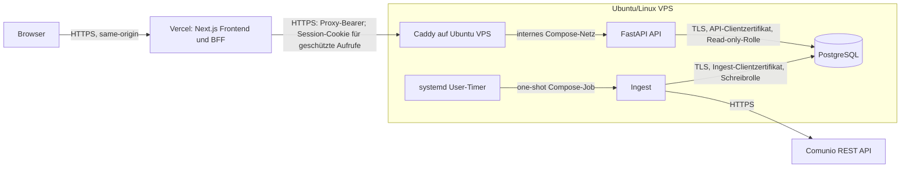

# Comunio Data Website — aktuelle Architektur

> **Verbindlicher Standard:** Neue Backend-, Ingest-, Datenbank- und
> Betriebsfeatures zielen auf Ubuntu/Linux VPS mit Docker Compose, FastAPI,
> PostgreSQL, Caddy und systemd. Das Frontend bleibt auf Vercel. AWS ist eine
> historische, optionale Alternative und wird nur auf ausdrückliche Anfrage
> geändert oder ausgerollt.
>
> Dokumentationsstand: 2026-11-16.
> Dieses Dokument beschreibt die aktuelle Soll-/Code-Architektur. Der letzte
> vollständige Deployment-Check stammt vom 2026-11-08. Die gezielte
> Importdiagnose und das Ingest-Deployment vom 2026-11-16 sind im
> [VPS-Runbook](infra/vps/README.md) dokumentiert.
> Historische AWS-Entscheidungen stehen in den
> [AWS-Altarchitektur-Notizen](docs/architecture/aws-legacy-notes.md).

## 1. Systemkontext und Plattform

Die Plattform liest Comunio-Daten täglich ein, speichert Snapshots in
PostgreSQL und stellt sie über eine read-only FastAPI dem Next.js-Frontend zur
Verfügung. Der Browser kommuniziert nur mit der Vercel-Origin. Next.js
Serverrouten vermitteln authentifizierte API-Aufrufe zwischen Vercel und dem
VPS.

### Plattformentscheidungen

- **Frontend und BFF:** Next.js auf Vercel. Vercel Preview-Deployments
  unterstützen PR-Tests; deren API-Origin wird nur für das konfigurierte
  Vercel-Projekt-/Team-Muster freigegeben.
- **Backend und Datenpipeline:** getrennte FastAPI- und Ingest-Container auf
  dem Linux-VPS.
- **Persistenz:** PostgreSQL als Compose-Service mit persistentem Volume.
- **Eingang:** Caddy ist der einzige Compose-Service mit veröffentlichten
  HTTP(S)-Host-Ports. Er bedient HTTPS auf Port 443 sowie
  HTTP-zu-HTTPS-Weiterleitung auf Port 80. API und Datenbank veröffentlichen
  keine Host-Ports.
- **AWS:** kein Standardziel für neue Arbeit. Die AWS-Dateien bleiben als
  optionale, historische Alternative erhalten; ihr Inhalt belegt keinen
  aktuellen Live-Zustand eines AWS-Kontos.

## 2. Komponenten und Vertrauensgrenzen

### 2.1 Vercel / Next.js

- Rendert die Weboberfläche und stellt gleich-origin Routen unter
  `/api/auth/*` und `/api/proxy/*` bereit.
- Hält `API_PROXY_SECRET` serverseitig und reicht es als Bearer-Token an die
  API weiter. Das Secret wird nicht an den Browser ausgeliefert.
- Leitet Session-Cookies an die API weiter und setzt Auth-Cookies aus
  API-Antworten am Browser.
- Die Frontend-Guard-Logik prüft nur, ob ein Cookie vorhanden ist. Die API
  validiert Signatur und Claims und ist die Autorität für den Zugriff.

### 2.2 VPS-Netzwerk und Caddy

- Caddy terminiert öffentliches HTTPS und leitet intern an den API-Container
  weiter. Der API-Container hängt am internen Datenbank- und API-Ingress-Netz;
  die Datenbank hängt nur am internen Datenbanknetz.
- Der Ingest-Container nutzt das Datenbanknetz und ein separates
  ausgehendes Netz für den Zugriff auf Comunio.
- Nur Caddy publiziert Ports auf dem Host. PostgreSQL (`5432`) und Uvicorn
  (`8000`) dürfen nicht öffentlich erreichbar sein.
- Caddy entfernt `CloudFront-Viewer-Address` und `Forwarded`; Uvicorn vertraut
  keinen Proxy-Headern. Die Login-Drosselung ist deshalb aktuell global statt
  client-IP-basiert (siehe Abschnitt 6).

### 2.3 FastAPI

- Stellt read-only-Endpunkte unter `/api/v1` sowie Auth-Routen unter `/auth`
  bereit. Der Ingest führt keine API-Requests aus.
- Geschützte API- und Auth-Routen benötigen sowohl eine gültige Session als
  auch das serverseitige Proxy-Bearer-Secret. `POST /auth/login` benötigt das
  Proxy-Secret, aber noch keine bestehende Session.
- `/health/live` und `/health/ready` sind für Betriebsprüfungen öffentlich;
  Readiness prüft zusätzlich die Datenbankverbindung.
- CORS ist auf erlaubte Origins und GET beschränkt. Mutierende Auth-Requests
  validieren den `Origin`-Header zusätzlich; Preview-Origins werden nur für
  das konfigurierte Vercel-Projekt-/Team-Muster akzeptiert.

### 2.4 PostgreSQL

- Läuft im Compose-Netz ohne veröffentlichten Host-Port und speichert
  Stammdaten, Snapshots, Ingest-Läufe und Historie.
- API und Ingest verwenden getrennte Datenbankrollen, URLs und
  Client-Zertifikate. Die API-Rolle ist read-only; der Ingest erhält die für
  Snapshots benötigten Schreibrechte.
- Datenbankverbindungen erzwingen TLS; das VPS-API-Profil verwendet
  `sslmode=verify-full` sowie eine eigene API-Clientidentität.
- Das persistente Volume schützt vor Datenverlust bei Container-Neustarts,
  ersetzt aber weder unabhängige Backups noch Restore-Tests.

### 2.5 Ingest und Scheduler

- Der Ingest ist ein kurzlebiger Containerjob, kein dauerhaft laufender
  Service. Er lädt Credentials und Datenbank-Zugangsdaten aus separaten,
  read-only eingebundenen Host-Dateien.
- Ein systemd **User-Timer** startet den Job täglich um 06:00 UTC. Der
  One-shot-Service lädt beide Compose-Dateien und aktiviert die `api`- und
  `jobs`-Profile. Er verwendet einen gemeinsamen `flock`-Lock, damit Timer-
  und unterstützte manuelle Läufe nicht parallel laufen.
- Der Job ruft Comunio über den eigenen `ComunioPyClient` ab, validiert und
  normalisiert Snapshots und schreibt sie idempotent in PostgreSQL.
- Der Spielerabruf verwendet `limit` und den von Comunio erwarteten Parameter
  `start`. `offset` lieferte im Live-Test wiederholt dieselbe erste Seite.
  Spieler-IDs werden über Seiten dedupliziert; eine weitere Seite ohne neue
  IDs lässt den Snapshot fehlschlagen statt unvollständige Daten als Erfolg
  zu speichern.
- Ingest-Login-Retries und Snapshot-Fetch-Retries sind getrennte
  Fehlerbehandlungen. Der Lauf liefert seinen Exit-Code an systemd zurück.

## 3. Daten- und Request-Flows

### 3.1 Authentifizierung und API-Aufruf

1. Der Browser sendet Login und spätere Datenanfragen an gleich-origin
   Next.js-Routen auf Vercel; er spricht den VPS nicht direkt an.
2. Der Next.js-Auth-Proxy leitet Login, Logout und Session-Abfragen weiter,
   ergänzt `API_PROXY_SECRET` und reicht den `Origin`-Header durch.
3. Die API lädt die Auth-Konfiguration aus der eingebundenen Datei,
   authentifiziert den einzelnen Benutzer und stellt ein JWT im Cookie
   `token` aus.
4. Das Cookie ist `Secure`, `HttpOnly`, `SameSite=Strict`, auf `/` begrenzt
   und hat eine Laufzeit von acht Stunden. Geschützte Anfragen benötigen
   dieses JWT und den zusätzlichen Proxy-Bearer.
5. Die API liest Daten mit ihrer getrennten Read-only-Rolle aus PostgreSQL
   und gibt Antworten ohne gemeinsam genutztes Caching zurück.

Das Logout löscht das Browser-Cookie. Es gibt keine serverseitige
Token-Widerrufsliste; ein bereits kopiertes JWT bleibt bis zum Ablauf gültig.
Eine Rotation des JWT-Secrets macht bestehende Tokens ungültig; danach muss
die API neu gestartet werden, damit der Prozess das rotierte Secret lädt.

### 3.2 Ingest

1. systemd startet den Compose-Job und hält den gemeinsamen Lauf-Lock.
2. Der Ingest authentifiziert sich bei Comunio und lädt die Spielerseiten mit
   `limit`/`start` bis zur gemeldeten Trefferzahl.
3. Doppelte Spieler-IDs werden zusammengeführt; eine Seite ohne neue IDs wird
   als Abruffehler behandelt.
4. Daten werden validiert und idempotent in PostgreSQL geschrieben.
5. Erfolg oder Fehler wird über Exit-Code und strukturierte Laufereignisse
   an systemd beziehungsweise die Job-Logs zurückgegeben.

### 3.3 Spielersuche und Seitennavigation

Die Client-Komponente der Spielerliste liest den Suchbegriff (`search`) und
den Seitenversatz (`offset`) aus der URL. Sie fordert über den Same-Origin-
Proxy jeweils bis zu 25 Spieler von `GET /api/v1/players` an. Die API filtert
den gesamten Spielerbestand nach Namen, bevor sie die Seite auswählt, und
liefert die gefilterte Gesamtzahl (`total`) zurück. Vorwärts und zurück
erhalten den Suchbegriff; eine neue Suche beginnt bei Versatz 0. URL und
Browser-Verlauf ermöglichen die Rückkehr zu einer vorherigen Suche oder Seite.
Diese Beschreibung betrifft den Code-Stand und bestätigt kein Deployment.

## 4. Secrets und Betriebsgrenzen

- Produktionssecrets liegen in Host-Dateien außerhalb des Repositories und
  werden nur in die jeweils benötigten Container read-only eingebunden.
- Auth-, Proxy-, API-Datenbank- und Ingest-Zugangsdaten sind getrennt.
  Private TLS-Schlüssel liegen ebenfalls außerhalb des Repositories.
- Container laufen mit numerischen, nicht privilegierten UIDs/GIDs,
  read-only Root-Dateisystemen, reduzierten Capabilities und Ressourcenlimits.
- Die Compose- und systemd-Prüfungen in CI validieren Konfiguration und
  Sicherheitsgrenzen; sie beweisen nicht den Live-Zustand des VPS.
- Änderungen werden lokal in Linux-kompatibler Umgebung oder CI entwickelt
  und geprüft. Produktionsänderungen sind ein separater, ausdrücklich
  freizugebender Deployment-Schritt.

## 5. API-Vertrag und Qualitätsziele

- API-Vertrag und Datenprojektionen sind in
  [`backend/src/api/app.py`](backend/src/api/app.py),
  [`backend/src/api/schemas.py`](backend/src/api/schemas.py) und
  [`data_model.md`](data_model.md) maßgeblich.
- Vorgesehene Qualitätsziele sind unter 500 ms API-P95 für definierte
  Standardabfragen und unter zwei Sekunden Seitenladezeit. Sie sind Ziele,
  keine Zusicherung erreichter Produktions-SLOs.
- PostgreSQL-Integrationstests, OpenAPI-Vertragsprüfungen und das
  Benchmark-Skript decken Anwendung und Datenzugriff ab. Ein erfolgreicher
  lokaler Build oder Compose-Check ersetzt keine Laufzeitmessung.

## 6. Verfügbarkeit, Risiken und offene Betriebsarbeit

### Bekannte Einschränkungen

- API und Datenbank teilen sich einen einzelnen VPS als Ausfallbereich;
  automatisches Host-Failover oder redundante Datenbankknoten sind nicht
  eingerichtet. Das Projektziel von 99,9 % Verfügbarkeit ist daher weder ein
  zugesichertes SLA noch durch die aktuelle Topologie nachgewiesen.
- Der VPS setzt einen API-Worker und ein globales, im Prozess gespeichertes
  Login-Limit von fünf Versuchen je fünf Minuten ein. Alle Nutzer teilen das
  Limit; ein Neustart setzt den Zähler zurück. Die VPS-Dokumentation hält
  dieses Verhalten als akzeptierten Übergangszustand fest. Vor mehreren
  Workern/Replicas ist ein gemeinsamer Rate-Limiter erforderlich.
- Ein JWT wird beim Logout nicht serverseitig widerrufen und bleibt bis zu
  acht Stunden gültig, wenn es zuvor kopiert wurde.
- Laut letztem dokumentiertem VPS-Check vom 2026-11-08 waren regelmäßige
  Backups/Restore-Überwachung, Monitoring/Alerting und VPS-Speicherverschlüsselung
  noch offene Punkte. Diese Statusangabe ist historisch und
  muss vor einer Betriebsentscheidung im [VPS-Runbook](infra/vps/README.md)
  erneut verifiziert werden.
- Der erste geplante VPS-Lauf wurde am 2026-11-08 mit 600 Datensätzen
  dokumentiert. Das Runbook hielt den Nachweis eines späteren Timerlaufs
  ohne Compose-„orphan container“-Warnung damals noch offen.

### Mindestanforderungen vor weiterem Verfügbarkeitsversprechen

- Automatisierte, unabhängige Backups mit regelmäßigen Restore-Tests und
  definierten RPO/RTO.
- Alarmierung für fehlgeschlagene oder ausgebliebene Ingest-Läufe,
  API-/Datenbankverfügbarkeit, Ressourcen- und Speicherknappheit sowie
  Backupfehler.
- Dokumentierter Wiederanlauf- und Rollbackpfad für VPS- und Datenbankausfall.
- Wiederholte Last- und Laufzeitmessungen, bevor API-P95 oder Seitenladezeit
  als erreichte Betriebsziele ausgewiesen werden.

## 7. AWS-Alternative

AWS bleibt als historische, optionale Alternative im Repository. Neue
Features erhalten keine AWS-Ressourcen, Laufzeitpfade oder Deployments, sofern
eine Aufgabe AWS nicht ausdrücklich verlangt.

- [Historische AWS-Architektur und Projektentscheidungen](docs/architecture/aws-legacy-notes.md)
- [AWS-Deployment- und Terraform-Dokumentation](infra/aws/README.md)

Historische AWS-Dokumente sind kein Nachweis für aktive Ressourcen. Ein
aktueller AWS-Zustand darf nur nach ausdrücklich autorisierter Live-Prüfung
beschrieben oder geändert werden.
