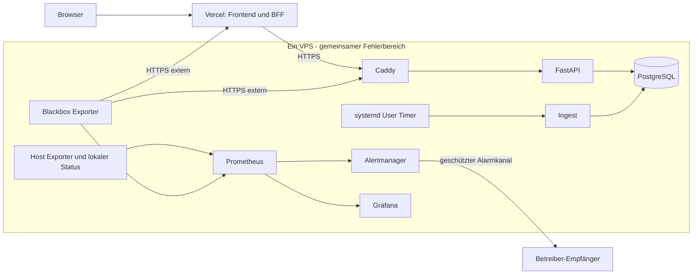
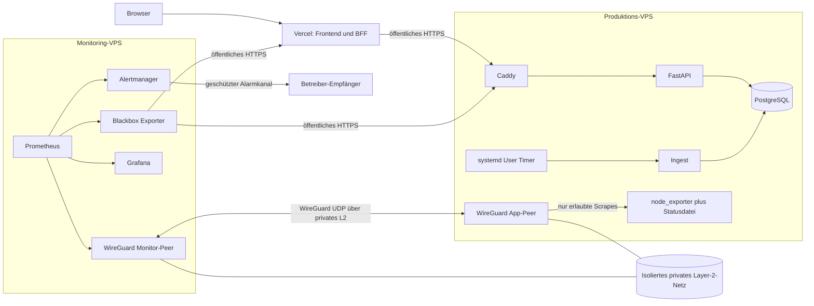

# Plan: Selbstgehostetes Monitoring für das Gesamtprojekt

Planungsstand: 20.11.2026. **Entwurf; nicht implementiert oder freigegeben.**
Der Plan fasst die Beiträge von Project Architecture Planner und Security
zusammen und beschreibt zwei Varianten. **Aktualisierung 20.11.2026:** Der
Architekt hat Variante 2 für ein isoliertes privates Layer-2-Netz überarbeitet.
Er beruht auf dem Repository und
datierten Betriebsberichten, nicht auf einer aktuellen Prüfung der Server,
Firewall, Vercel- oder GitHub-Einstellungen. Maßgeblich für den bestehenden
Betrieb bleibt das [VPS-Runbook](../../infra/vps/README.md); ergänzend siehe
[Security-Bewertung](../code-review/2026-11-20-self-hosted-monitoring-security-review.md)
und [CD-Plan](vps-cd-pipeline-plan.md).
Die Security-Bewertung beschreibt den ursprünglichen WireGuard-WAN-Entwurf;
die überarbeitete L2-Variante ist darin noch nicht erneut bewertet worden.

## 1. Ziel, Kosten und Einschränkungen

Überwacht werden sollen Vercel-Frontend und Backend-for-Frontend (BFF), HTTPS
und DNS, VPS und Docker-Dienste, FastAPI, PostgreSQL, täglicher Ingest,
Datenfrische, Backups, geplante CD sowie das Monitoring selbst. Fehler sollen
mit praktikablen Schwellwerten erkannt und an einen Betreiber gemeldet werden.

**Kostenlos heißt hier: keine Lizenz- oder Nutzungsgebühren für die
vorgeschlagenen selbstgehosteten OSS-Werkzeuge.** VPS, Speicher, Traffic,
Domain, Strom und Betriebszeit sind nicht kostenlos. Variante 2 benötigt einen
zweiten VPS und verursacht deshalb zusätzliche Hostingkosten; ein kostenloser
zweiter Server wird nicht vorausgesetzt. Auch ein externer Mail- oder
Pushdienst könnte Geld kosten und wäre nicht vollständig selbstgehostet.

Alle vorgeschlagenen Monitoring-Komponenten und der bevorzugte Alarm-Empfang
werden selbst betrieben, ohne Monitoring-SaaS. Das bestehende Frontend bleibt
jedoch auf Vercel, und GitHub hostet das Repository und die CI/CD: Diese
externen Plattformen selbst werden nicht auf den VPS verlagert. Ein
selbstgehosteter Monitor kann ihre öffentlichen Schnittstellen prüfen, aber
keinen uneingeschränkten Einblick in deren interne Infrastruktur garantieren.

## 2. Ausgangslage und Entscheidung

- Die Plattform verwendet laut [Architektur](../../architecture.md) und
  VPS-Runbook Vercel/Next.js, Caddy, FastAPI, PostgreSQL, Docker Compose und
  einen systemd-User-Timer. PostgreSQL und die API haben keinen öffentlichen
  Host-Port; Caddy stellt HTTPS bereit.
- API-`/health/live` und `/health/ready` sind vorhanden. Readiness prüft den
  Datenbankzugriff, aber nicht Ingest-Erfolg, fachliche Datenfrische,
  Backups oder die gesamte Benutzerfunktion.
- Der Timer plant den Ingest für **06:00 UTC**; der Service hat ein
  30-Minuten-Timeout und nutzt einen gemeinsamen Lock. Nicht jeder Fehler
  erreicht die Tabelle `ingest_runs`, etwa bei Problemen vor der
  DB-Registrierung. Ein erfolgreicher Login-Test ist kein Snapshot-Erfolg.
- Regelmäßige Backups, Restore-Überwachung und Alarmierung sind laut Runbook
  offene Aufgaben. Die [CI](../../.github/workflows/ci.yml) existiert; die
  VPS-CD-Pipeline ist erst geplant. Daraus folgt kein Live-Status.

| | Variante 1: gleicher VPS | Variante 2: zweiter VPS |
|---|---|---|
| Ort | Monitoring neben API und DB | Monitoring separat; kleine Exporter auf dem App-VPS |
| Vorteil | Kein zweiter Server; weniger Setup | Erkennt einen App-VPS-Ausfall aus einem anderen Fehlerbereich |
| Nachteil | Host-, Netzwerk-, Docker- oder Disk-Ausfall kann App **und** Alarmierung ausschalten | Kosten und Betriebsaufwand für zweiten VPS, privates L2 und Tunnel |
| Grenze | Kein unabhängiger Alarm bei Totalverlust des eigenen Hosts | Monitoring-VPS, Provider, L2, Tunnel und Alarmempfang können ebenfalls ausfallen |
| Empfehlung | Kostensparender Einstieg bei akzeptierter Blindstelle | Bevorzugte Zielvariante für verlässlichere Alarme |

Ein zweiter VPS beim gleichen Anbieter kann bei Provider-, Standort- oder
Netzausfall gleichzeitig betroffen sein. Ein anderer Standort oder Anbieter
verringert, beseitigt aber nicht alle gemeinsamen Ausfallursachen.

## 3. Gemeinsamer Werkzeugkasten

| Komponente | Aufgabe | Einsatz |
|---|---|---|
| Prometheus | Metriken sammeln, aufbewahren und Alarmregeln auswerten | Beide Varianten |
| Alertmanager | Alarme gruppieren, Ruhezeiten verwalten und an Empfänger zustellen | Beide Varianten |
| Grafana OSS | Geschützte Dashboards für Übersicht und Fehlersuche | Beide Varianten |
| node_exporter | Host-CPU, RAM, Dateisystem, Inodes, Netzwerk; Textfile-Collector für lokale Betriebszustände | Auf jedem überwachten VPS |
| blackbox_exporter | HTTP(S)-, DNS-, Zertifikats- und Latenz-Proben | Auf dem Monitoring-Host |
| Kleiner lokaler Status-Collector | Reduzierte, atomar geschriebene Metriken für **systemd-User**-Timer, Snapshot und optional Backup/CD | Auf dem App-VPS; muss neu entwickelt werden |
| WireGuard | Verschlüsselter Peer-zu-Peer-Tunnel über privates L2 | Nur Variante 2 |
| PostgreSQL-Exporter, Loki/Alloy, API-Metriken | Detailliertere DB-Metriken, zentrale Logs bzw. Request-Metriken | Optional und erst nach eigener Rechte-/Datenschutzprüfung |

Die zentrale Sammlung und Dashboards können in einem separaten, versionierten
Docker-Compose-Projekt laufen; kleine Host-Exporter können als eigene,
unprivilegierte systemd-Dienste betrieben werden. Konfiguration, Alarmregeln,
Dashboards und Tests gehören versioniert ins Repository, Secrets nicht.
Images sind auf geprüfte Versionen bzw. Digests festzulegen und regelmäßig zu
aktualisieren. Retention, persistente Volumes, Neustartverhalten und begrenzte
Ressourcen werden explizit konfiguriert. Weder der Stack noch Grafana benötigen
Zugriff auf den Docker-Socket.

Der node_exporter-Systemd-Collector darf **nicht** ungeprüft als Überwachung
des bestehenden systemd-**User**-Managers verstanden werden. Der neue lokale
Collector muss nachweislich genau den Benutzer-Timer, die Serviceinstanzen
und deren tatsächlichen Endstatus erfassen. Der Textfile-Collector liefert nur
Werte aus lokal kontrollierten Dateien; er erkennt nicht von selbst, ob ein
Run stattgefunden hat. Ein Pushgateway ist für diesen hostgebundenen Job
nicht die erste Wahl; dessen Werte bleiben ohne Löschstrategie sonst bestehen.

## 4. Variante 1: Monitoring auf demselben VPS

Exporter, Prometheus und Alertmanager nur über Loopback oder dafür vorgesehene
private Netze erreichbar machen. Grafana nur über einen administrativen
SSH-Tunnel bzw. ein separat abgesichertes Operator-VPN. Monitoring nicht
pauschal an das Datenbanknetz hängen. Wenn der Produktions-VPS oder sein
Internetanschluss ausfällt, kann der lokal betriebene Monitor **keinen**
eigenen Alarm mehr verschicken. Diese Grenze lässt sich nicht durch ein
Dashboard, einen lokalen Heartbeat oder einen Neustartmechanismus auf demselben
Host beseitigen.

## 5. Variante 2: zweiter Monitoring-VPS mit isoliertem L2

Das isolierte L2 ist das private **Underlay** zwischen den beiden VPS;
WireGuard bildet darüber den authentisierten, verschlüsselten Tunnel.
Prometheus fragt gezielt die App-Exporter durch diesen Tunnel ab; die
Blackbox-Proben nutzen unabhängig davon die öffentlichen HTTPS-Adressen.
Damit können beispielsweise L2-, Tunnel- oder Exporterstörungen von einem
weiterhin öffentlich erreichbaren Dienst unterschieden werden. Ein
App-Host-Ausfall kann vom Monitoring-VPS erkannt werden, sofern Monitor und
Benachrichtigungskette funktionsfähig bleiben. Der Monitoring-VPS ist selbst
kein hochverfügbarer Verbund.

### Netzverbindung und Firewall

**Annahmen statt Live-Nachweis:** Der Provider stellt beiden VPS eine eigene
private L2-Schnittstelle im selben isolierten Segment bereit. Anbieter,
Standorte, Teilnehmerkreis, Adressvergabe, Filter- und Anti-Spoofing-Funktionen
sowie Kosten sind noch nicht geprüft. Isolation ist weder automatisch
Verschlüsselung noch ein Beweis, dass andere Teilnehmer keine Pakete
mitlesen oder manipulieren können. Deshalb wird der Exporterverkehr zusätzlich
mit WireGuard geschützt. Der Tunnel nutzt ausschließlich private L2-Adressen;
es ist dafür **kein öffentlicher UDP-Port** vorgesehen.

Adressbeispiel, vor Implementierung auf tatsächliche Provideranforderungen und
Überschneidungen mit Host- und Docker-Netzen prüfen:

| Ebene | Produktions-VPS | Monitoring-VPS |
|---|---|---|
| Privates L2-Interface, IPv4-Beispiel | `10.98.0.1/24` | `10.98.0.2/24` |
| WireGuard-Overlay | `10.99.0.1/32` | `10.99.0.2/32` |

Der Monitor verbindet sich zum privaten L2-Endpunkt `10.98.0.1:51820/udp`.
Beide Hosts haben eigene WireGuard-Schlüssel; `AllowedIPs` enthalten jeweils
nur die gegenüberliegende Overlay-IP. Keine Default-Route über das private
L2 oder WireGuard und kein allgemeiner Transit in DB-, Docker- oder
Operator-Netze. `PersistentKeepalive` ist nur bei entsprechendem Bedarf
vorzusehen. Private Schnittstelle und Overlay erhalten je eigene
Firewallregeln.

| Quelle → Ziel | Freigabe | Zweck |
|---|---|---|
| Internet → App-VPS | TCP 80/443 | Bestehendes Caddy-HTTPS; API und DB bleiben privat |
| Monitor-L2-IP → App-L2-IP | UDP 51820, nur privates Interface | WireGuard-Transport; kein öffentlicher UDP-Zugang. Rückverkehr zustandsbehaftet erlauben |
| Monitor-Overlay-IP → App-Overlay-IP | TCP 9100, nur WireGuard-Interface | Ausschließlich node_exporter mit dem ausgewählten Status-Collector |
| Monitor → öffentliche Vercel-/API-Domains | TCP 443, DNS nach Bedarf | Synthetische Prüfungen aus dem Monitor-VPS |
| autorisierter Operator → jeweiliger VPS | administratives SSH, nur erlaubte Quellen | Wartung; Grafana über SSH-Tunnel, nicht über ein öffentliches Dashboard |
| Alertmanager → selbstgehosteter Empfänger | Nur festgelegter geschützter Kanal | Alarmzustellung; konkrete Lösung und Verfügbarkeit vorab festlegen |

Eingehend sonst grundsätzlich verweigern, etablierte Antwortverbindungen
zulassen; Provider- und Host-Firewall sowie IPv4 **und** IPv6 prüfen. Exporter
binden auf dem App-Host nur an die WireGuard-IP, und die Host-Firewall erlaubt
nur den Monitor-Peer. PostgreSQL 5432, Uvicorn 8000, Exporter, Prometheus,
Grafana und Alertmanager werden nicht im öffentlichen Internet veröffentlicht.
Es ist keine direkte DB-Verbindung vom zweiten VPS nötig.

Die WireGuard-Implementierung kann den UDP-Port auf allen Host-Interfaces
öffnen. Der private Endpoint allein beschränkt das Binding nicht: Der
öffentliche UDP-Zugang muss über Provider- und Host-Firewall für IPv4 und IPv6
aktiv gesperrt und von außen getestet werden. Auf dem privaten Interface ist
nur die UDP-Verbindung zwischen den vorgesehenen L2-Adressen erlaubt;
WireGuard-Peer-Keys authentisieren zusätzlich.

Das private Interface nicht mit Docker oder dem öffentlichen Interface
bridgen; keine allgemeinen Netze darüber routen. Der Provider muss den
Teilnehmerkreis, Segment-Isolation, MAC-/IP-Spoofing, ARP, IPv6-NDP und
Router Advertisements nachvollziehbar beschreiben; nicht belegte
Eigenschaften bleiben unbekannt. IPv6 auf dem privaten Interface entweder
gezielt abschalten und auch Link-Local und Container prüfen oder mit eigener
Adressierung, NDP-/RA-Policy und gleichwertigen Firewallregeln absichern.
Auch die tatsächlichen Firewallpfade von Docker und eventuell erlaubtes
containerbezogenes Forwarding sind gesondert zu prüfen.

Prometheus in Docker benötigt eine explizit getestete Route vom
Monitoring-Container zum WireGuard-Peer und eine passende Rückroute bzw.
gezieltes SNAT zur Monitor-Tunnel-IP. Firewallregeln müssen die tatsächlich
auftretende Quelladresse und Docker-Weiterleitung berücksichtigen; eine
Host-Firewallregel allein ist kein Nachweis für sicheren Docker-Port-Publish.
Alternativ kann Prometheus als nicht privilegierter Host-Dienst laufen. Vor
Freigabe sind beide Richtungen, Rückweg und Negativfälle in der Testumgebung
nachzuweisen. WireGuard-Schlüssel auf den Hosts restriktiv speichern, rotieren
und widerrufen können; kein automatischer Vertrauensaufbau aus ungeprüften
Schlüsselwerten.

## 6. Was gemessen und alarmiert wird

Die Werte sind **Startvorschläge**, keine bereits gemessenen SLOs. Messintervall,
Schwellwerte und Zuständigkeit nach Test und Lastdaten festlegen. Bei
Scrape-Ausfall ist „unbekannt“ ein eigener Alarm und niemals „gesund“.

| Bereich | Messung und Quelle | Start-Regel / Aussagegrenze |
|---|---|---|
| Frontend | HTTPS-Blackbox auf `/login`, Status, Latenz, TLS und DNS | 1 Probe/min; nach 3 aufeinanderfolgenden Fehlern Alarm. Belegt keine funktionierende Browser-JavaScript-Interaktion oder Anmeldung. |
| Vercel-BFF | `/api/proxy/health/ready` über Vercel, ohne Nutzer-Cookie; [Proxyroute](../../frontend/app/api/proxy/%5B...path%5D/route.ts) leitet zum Backend weiter | Wiederholte Nicht-200/Timeouts melden; Route/Base-URL und Verhalten in Testumgebung prüfen. Der vorhandene Upstream-Timeout beträgt 8 s, deshalb Probe-Timeout ausreichend darüber wählen. Kein vollständiger Login-/Fachdaten-Test. |
| API/Caddy/DB | Öffentliche `/health/live` und `/health/ready`, getrennt von BFF | Wiederholte Nicht-200 melden; Readiness prüft DB-Zugriff, Liveness nicht. HTTPS-Zertifikatsrestlaufzeit z. B. unter 30 Tagen warnen. |
| Host und Speicher | node_exporter für beide Hosts, Dateisystem, Inodes, RAM, CPU, Netzwerk | Disk/Inodes z. B. >80 % Warnung, >90 % kritisch; zusätzlich Mindestfreiraum und Dauer festlegen. Überwachte Mounts und Docker-Speicher explizit auswählen. |
| Timer/Job | Lokaler User-systemd-Collector: Timer aktiv, letzter Start/Ende, Exitcode und Ergebnis | Ausfall/Exitcode inklusive Lock-Konflikt 75 und Timeout melden. Keine Abhängigkeit allein von `ingest_runs`; auch Fehler vor DB-Anmeldung erfassen. |
| Tageserfolg | Gesonderter bestätigter Snapshot-Erfolgsmarker und UTC-Datum | Täglich zunächst Alarm, wenn bis **07:00 UTC** kein erfolgreicher geplanter Snapshot für den aktuellen UTC-Tag nachweisbar ist. Gesonderte manuelle oder reine Login-Läufe dürfen diesen Alarm nicht verdecken. |
| Datenqualität | Aggregierte Schreibzahl und tatsächliches Snapshot-Datum aus vertrauenswürdiger Quelle | Null bzw. auffälliger Rückgang zunächst warnen; feste Spieleranzahl nicht unterstellen. Zeitpunkt des Prozessendes allein beweist keine frischen oder vollständigen Daten. |
| PostgreSQL | API-Readiness; optional lokaler DB-Exporter mit eigener enger Rolle und TLS | Status, Verbindungen und DB-Speicher nur nach Rechteprüfung. Kein DB-Zugang aus dem Internet oder Grafana; keine fachlichen Daten exportieren. |
| Container/Proxy | Health-/Blackbox-Signale, ggf. gezielte Host-Service-Zustände | Keine Aussage über Container-Restarts vortäuschen, solange kein sicherer Collector dafür eingerichtet ist. cAdvisor/Docker-Socket erst nach separater Sicherheitsentscheidung. |
| Backup/Restore | Sobald implementiert: letzter bestätigter Backup-Erfolg, Alter, Jobfehler und letzte Restore-Probe | Fehlen/Überfälligkeit alarmieren. Backup-Scheduling und Restore-Probe existieren nicht allein durch diesen Plan. |
| CI/CD | GitHub-Status und geplanter Deploy-Status, z. B. über begrenzte GitHub-API-Abfrage bzw. gesicherten Release-Status | Nur mit minimal lesender Identität und überprüftem Event-/SHA-Bezug. GitHub-Ausfall und keine Daten gesondert melden. Der zukünftige CD-Workflow existiert noch nicht. |
| Monitoring | Scrape-Fehler, Regel-Auswertung, Alertmanager-Zustellung, freier Platz, L2-Pfad und Tunnel | Bei Variante 2: Scrape-Ausfall bei weiterhin erfolgreicher HTTPS-Probe als mögliche L2-/Tunnel-/Exporter-Störung markieren. Eigenen vollständigen Hostausfall kann der Monitor nicht selbst melden. |

**Ingest-Statusvertrag für die spätere Implementierung:** Start, erfolgreicher
Snapshot-Abschluss und Fehler/Timeout/Lock-Konflikt müssen getrennt und über
Neustarts hinweg auswertbar sein. Den Erfolgsmarker nur nach bestätigtem
Ergebnis eines geplanten Snapshot-Jobs aktualisieren, nie vor Jobende, und
Dateien atomar ersetzen. Fehler beim Schreiben des Markers müssen sichtbar
sein; alter, fehlender oder ungültiger Marker ist kein Erfolg. Prozess- und
Fachdatenfrische getrennt halten: Ein Catch-up oder manueller Lauf kann ein
anderes UTC-Datum erzeugen und darf einen fehlenden Tag nicht nachträglich als
erfasst darstellen. Die 07:00-Regel ist gegen Timer-Catch-up, Wartungsfenster,
Zeitsynchronisation, verzögerte Starts und den 30-Minuten-Timeout zu testen.

## 7. Benachrichtigung und Selbstüberwachung

Alertmanager sendet gruppierte, möglichst datenarme Alarme und
Wiederherstellungsmeldungen an einen **selbstgehosteten, zugriffsgeschützten
Empfangsdienst**, beispielsweise einen separat betriebenen Push-Endpunkt mit
Operator-Client über einen abgesicherten Zugang. Produkt, Client,
Authentisierung, Netzwerkweg, Offline-Verhalten und Betriebsverantwortliche
sind noch zu entscheiden und in der Testumgebung nachzuweisen. Eine
Smartphone-Push-Funktion, die dennoch einen fremden Pushdienst nutzt, wäre
eine externe Abhängigkeit und darf nicht als vollständig selbstgehostet
ausgegeben werden.

Ein Empfangsdienst auf demselben Monitoring-Host vereinfacht den Aufbau, fällt
aber mit diesem aus. Ausgehende Alarmzustellung meldet ihren eigenen
Totalausfall nicht. Für die Erkennung dieses Falls braucht es einen **dritten,
unabhängigen** Beobachter/Empfänger, zum Beispiel ein vom Betreiber dauerhaft
betriebenes Gerät, das einen regelmäßigen Heartbeat erwartet und bei dessen
Ausbleiben lokal alarmiert. Gerät, Verbindung und Alarmmöglichkeit verursachen
eigenen Aufwand und müssen getestet werden. Ohne einen solchen dritten
Fehlerbereich bleibt der Ausfall des Monitoring-VPS ausdrücklich unüberwacht;
auch ein periodischer Testalarm allein garantiert keine Zustellung.

## 8. Sicherheit und Datenschutz

- Zugriffe standardmäßig verweigern; Dashboards nur für benannte Operatoren,
  keine anonymen Dashboards, starke Zugangsdaten und MFA, soweit praktikabel.
  SSH-, Tunnel-, DB- und Alert-Identitäten trennen und Rotation dokumentieren.
- Keine Secrets in Git, Images, Metriklabels, Alerts oder Prozessargumenten;
  getrennte, restriktive Host-Dateien und read-only Mounts verwenden. Kein
  Docker-Socket oder Docker-Gruppenzugriff für Monitoring; beides ist
  praktisch Root-Zugriff.
- DB-Exporter nur optional auf dem App-VPS: eigener TLS-Client und
  minimalberechtigte Rolle; keine Wiederverwendung des Ingest- oder API-Users.
  Für Details nötige Rechte vorab nachweisen. Nur der Exporter, nicht der
  ganze Monitoring-Stack, erhält Zugriff auf das DB-Netz.
- Keine Tokens, Cookies, DSNs, Rohantworten, personenbezogenen
  Besitzer-/Spielerdaten, Querystrings oder unbeschränkt variable Labels
  speichern. Zentrale Logs sind **nicht** Teil der ersten Ausbaustufe:
  bisherige lokale Logs bleiben erhalten; optionales Loki/Alloy benötigt
  gesonderte Datenminimierung, Authentisierung, Retention und Löschtests.
- Monitoring-Daten und -Konfiguration vor unbefugtem Zugriff schützen;
  verschlüsselte Sicherungen und deren Wiederherstellung planen. Der bislang
  dokumentierte offene Punkt VPS-Speicherverschlüsselung bleibt bestehen.
  Die Anwendung erhält durch Monitoring keine neuen öffentlichen Ports.

## 9. Ressourcen, Aufbewahrung und Betrieb

### Architektur-Einschätzung für den zweiten VPS

Unverbindliche Startdimensionierung des Architekten, **keine Messwerte oder
Kapazitätsgarantie**. Annahmen: zwei überwachte Hosts, wenige HTTPS-Proben und
Operatoren, Prometheus, Alertmanager, Grafana OSS, Blackbox-Exporter und
WireGuard; 15 Tage Metriken, zunächst **keine zentralen Logs**. Der zweite VPS
betreibt keine Produktionsdatenbank und keinen Ingest.

| Ausbaustufe | vCPU | RAM | SSD | Einschätzung |
|---|---:|---:|---:|---|
| Minimum ohne Loki | 2 | 2 GB | 30 GB | Nur bei geringer Last und nach erfolgreichem Lasttest; wenig Reserve für Updates und Fehleranalyse. |
| **Empfohlener Start ohne Loki** | **2** | **4 GB** | **60 GB** | Angemessener Ausgangspunkt für die oben genannten Annahmen. |
| Mit optionalem Loki/Alloy | 2 | 6 GB, alternativ 8 GB bei verfügbaren Tarifen | 100 GB | Ausgangspunkt bei begrenzten, bereinigten Logs und 7 Tagen Retention; Volumen messen. |

Zwei vCPU bieten Reserve für Scrapes, Abfragen und Prometheus-Compaction;
ein vCPU wäre für diesen Betrieb knapp. Bei häufigen Dashboard-Abfragen,
hoher Kardinalität oder größerem Logvolumen können mehr CPU, RAM oder Speicher
nötig sein. Die Schätzwerte sind keine feste Tarif- oder Leistungszusage;
insbesondere Shared-vCPU-Leistung und tatsächlich nutzbarer Speicher hängen
vom Anbieter ab. Kosten und Verfügbarkeit des privaten L2-Netzes sowie
Bindung an Anbieter und Standort sind ungeprüft.

#### RAM-Budget ohne Loki

Grobe Bereiche für die Planung, keine Prozesslimits: Betriebssystem, Docker
und Netzwerk etwa 0,7–1,2 GB; Prometheus 0,5–1,2 GB; Grafana 0,2–0,5 GB;
Alertmanager und Blackbox-Exporter zusammen 0,2–0,5 GB. Zusätzlich etwa
0,8–1 GB Reserve für Updates, Dateicache, Spitzen und Diagnose vorsehen.
Diese Bereiche sind nicht unabhängig zugesicherte Obergrenzen: Ihr oberes
Ende kann zusammen 4 GB überschreiten. Reale Spitzen, Head-Block,
Serienwechsel und gleichzeitige Abfragen messen; falls die Reserve nicht
reicht, größeren Tarif wählen. Der Alarm-Empfangsdienst ist darin nicht
konkret dimensioniert und benötigt gegebenenfalls zusätzliche Ressourcen.

#### Beispielrechnung für Prometheus-Speicher

Annahmen für die Rechnung: 1.000–2.500 aktive Zeitreihen, 30 Sekunden
Scrape-Intervall und 15 Tage Retention. Synthetische Proben können langsamer
laufen; hier werden sie konservativ ebenfalls mit 30 Sekunden gerechnet.

`Zeitreihen × (86.400 / 30 Samples pro Tag) × 15 Tage`

Das ergibt etwa **43,2 bis 108 Millionen Samples**. Mit den von Prometheus
genannten groben **1–2 Byte je Sample** entspricht das rund **43–216 MB**
für Sample-Daten. Indizes, Head, WAL, Compaction, Metadaten und wechselnde
Serien kommen hinzu; der tatsächliche Gesamtverbrauch ist daher höher.
Unbegrenzte Labels können sowohl Serienzahl als auch Speicherbedarf stark
erhöhen. Quelle und Grenzen der Näherung:
[Prometheus Storage](https://prometheus.io/docs/prometheus/latest/storage/).

Für den Start auf einer 60-GB-SSD beispielsweise 12–15 GB für Betriebssystem
und Pakete, 5–10 GB für Images/Container, **8 GB** für das Prometheus-Volume
und 2–4 GB für begrenzte lokale Logs einplanen; der Rest bleibt freie Reserve
für Updates, Diagnose und Wachstum. Diese Aufteilung ist ein Budget, keine
beobachtete Belegung. Als Ausgangswert Prometheus-Retention auf 15 Tage und
zusätzlich höchstens 5 GB setzen; die Größe des Volumes bleibt größer als die
Retention. WAL und temporäre Compaction können dennoch zusätzlichen Platz
benötigen. Eine getestete Quota bzw. getrennte Partition und Warnungen sind
zusätzlich erforderlich; bei voller Quota muss der Schreibfehler sichtbar
werden. Backups nicht als auf diesem VPS gesichert annehmen.

#### Optional: zentrale Logs und Netz

Loki und Alloy sind nicht im Startumfang. Bei beispielhaft 0,1–0,5 GB
Rohlogs pro Tag fallen bei sieben Tagen etwa 0,7–3,5 GB Rohdaten an, bevor
Kompression, Index, WAL und Betriebsreserve berücksichtigt werden. Tatsächliche
Quellen, Größen, Datenminimierung, Retention und Löschverhalten zunächst
messen; unbegrenzte Logs nicht aktivieren. Der 100-GB-Vorschlag ist deshalb
kein Ersatz für eine eigene Hochrechnung.

Der tatsächliche Scrape-Traffic hängt von der Exporter-Antwort ab. Zur
Einordnung: Bei **angenommenen** 100 KiB pro Scrape und einem über das
private L2 abgefragten Ziel alle 30 Sekunden entstehen etwa 281 MiB pro Tag
oder 8,2 GiB in 30 Tagen, zuzüglich Protokoll- und WireGuard-Overhead.
Bei 200 KiB verdoppelt sich das; weitere Ziele, Proben und Logs kommen hinzu.
Dies ist kein Messwert. Provider-Limits, öffentliches Probevolumen und
tatsächliche Payloadgrößen überprüfen.

#### Mess- und Abnahmepunkte

Vor Produktionsfreigabe die echten Exporter in einer Linux-Testumgebung
betreiben: Serienzahl und Churn, TSDB-Zuwachs, WAL/Compaction, CPU- und
RAM-Spitzen bei parallelen Scrapes und Grafana-Abfragen sowie Netzwerkverkehr
messen. Retention, Quota, voller Speicher, Neustart, Alarmzustellung und
Wiederherstellung testen. Nach den ersten ein bis zwei Wochen genehmigten
Betriebs die Werte erneut prüfen und den Tarif gegebenenfalls anpassen.

Für **Variante 1** bleibt die grobe Schätzung von zusätzlich 1–2 vCPU,
1,5–3 GB RAM und 20–50 GB Speicher bestehen; die Produktionslast und freie
Reserve des bestehenden VPS sind dafür gesondert zu messen.

Startvorschlag: Metriken 15 Tage, optionale Logs 7 Tage, anschließend
Verbrauch messen und Fristen begründen. Retention allein verhindert kein volles
Dateisystem zuverlässig. Monitoring-Speicher erhält eine getrennte
Partition/Quota mit zusätzlicher Reserve und eigenem Alarm; CPU-/RAM-Limits
und Schutz vor unkontrolliertem Logwachstum sind zu testen. Insbesondere bei
Variante 1 dürfen DB und Ingest durch den Monitoring-Stack nicht verdrängt
werden. Dashboard-/Regel-Konfiguration sichern, wiederherstellen und
aktualisieren; Monitoring ist **kein Datenbank-Backup**.

Vercel-interne Logs/Traces sind durch HTTP-Proben nicht vollständig sichtbar.
Laut [Vercel-Dokumentation zu Drains](https://vercel.com/docs/drains) hängen
Log-/Trace-Drains von Tarif und Nutzungsbedingungen ab und können Kosten
verursachen; sie sind deshalb keine Voraussetzung dieses kostenlosen Plans.
Eine weitergehende Integration erfordert eine gesonderte Entscheidung.

## 10. Einführung und Abnahme

1. **Festlegen:** Variante, Budget, Betreiber, Alarmempfänger, Routen,
   Retention, Reaktionszeiten, Datenqualität und Umgang mit Monitor-Ausfall
   entscheiden. Live-Inventur nur nach separater Autorisierung.
2. **Lokal/CI entwickeln:** Compose-Konfiguration, Prometheus-Regeln,
   Dashboards und lokalen User-systemd-Collector mit synthetischen Daten
   entwickeln. Kein Zugriff auf Produktionssecrets. Regeltests müssen
   Schwellen, UTC-Tageswechsel, fehlende Metriken und Resolved-Zustände prüfen.
3. **Isolierte Linux-Testumgebung:** API-, BFF-, DB-, Timer-, fehlender und
   fehlerhafter Ingest, alter Datenstand, Lock-Konflikt, niedrige Schreibzahl,
   Disk-/Inode-Schwellen und Backup-Überfälligkeit simulieren. Auch Markerfehler,
   06:00/07:00 UTC, Catch-up, Neustarts und falsche Uhrzeit testen.
4. **Netz und Security:** Variante 2 mit privatem L2, WireGuard über dessen
   private Endpunkte, korrektem Docker-Routing und beidseitigen
   Firewallregeln testen. Ungültige/widerrufene Peers ablehnen, öffentliches
   WireGuard-UDP sowie private Ports aus fremden Quellen über IPv4 und IPv6
   sperren. Routen, ARP-/NDP-/RA- und Spoofing-Annahmen, Rückwege und
   Neustartverhalten prüfen; keinen allgemeinen Transit zulassen.
   TLS-/DB-Rollen, Secret-Leaks, Label-Kardinalität und Quotas negativ testen.
5. **Alarmierung:** Zustellung, Gruppierung, Recovery, Wartungsfenster,
   abgeschalteten Empfänger und gegebenenfalls unabhängigen Heartbeat-Alarm
   tatsächlich prüfen. Jeweilige Blindstellen dokumentieren, statt
   Selbstüberwachung zu behaupten.
6. **Betriebsübergabe:** Runbook mit Zugang, Alarmbedeutung, Kontakt,
   Eskalation, Backup-/Restore-Verfahren, Key-Rotation und Recovery ergänzen.
   Produktionsinstallation und absichtliche Störungstests dort benötigen eine
   eigene ausdrückliche Freigabe. Danach den nächsten regulären Ingest
   beobachten, ohne für den Test produktive Snapshotdaten zu verändern.

## 11. Offene Entscheidungen

1. Variante 1 als günstiger Einstieg oder Variante 2 als Zielbetrieb? Falls 2:
   Budget, Anbieter, Standort, L2-Teilnehmerkreis, IPv4-/IPv6-Adressierung,
   Isolation, Anti-Spoofing sowie Netz-/Firewallmöglichkeiten und L2-Kosten?
2. Wer empfängt und bearbeitet Alarme, mit welchen Reaktionszeiten? Welcher
   vollständig selbstgehostete Empfangsweg und welches Gerät überwachen den
   Monitoring-Ausfall unabhängig?
3. Sind getrennte Quotas/verschlüsselte Speicher und unabhängige Backups auf
   den gewählten VPS verfügbar? Wer führt Restore-Proben durch?
4. Welche Datenqualitätsgrenzen, Aufbewahrungsfristen und Wartungsfenster sind
   angemessen? Werden später DB-Exporter, API-Metriken oder zentrale Logs
   benötigt?
5. Sollen Vercel- und GitHub-Details über deren Schnittstellen ergänzt werden,
   obwohl Zugang, Tarif und Verfügbarkeit außerhalb der selbstgehosteten
   Monitoring-Software liegen?

**Empfehlung:** Variante 2, sofern die zusätzlichen Hostingkosten tragbar sind;
sonst Variante 1 mit ausdrücklich akzeptierter Hostausfall-Blindstelle.
Kein Monitoring oder VPS-Netzwerk wurde durch diesen Plan eingerichtet.

## Quellen zu den vorgeschlagenen Werkzeugen

- [Prometheus: Hinweise zu Pushgateway und Textfile-Collector](https://prometheus.io/docs/practices/pushing/)
- [Alertmanager: Gruppierung und Alarmzustellung](https://prometheus.io/docs/alerting/latest/alertmanager/)
- [WireGuard: Einrichtung und Keepalive](https://www.wireguard.com/quickstart/)
- [Grafana OSS: Lizenz](https://github.com/grafana/grafana/blob/master/LICENSE)
