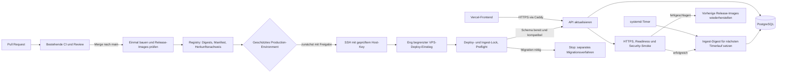

# Plan: Automatisches Deployment auf den VPS

Planungsstand: 20.11.2026. **Entwurf, nicht implementiert und nicht
produktiv freigegeben.** Dieser Plan führt die Beiträge von Project Architecture
Planner, Principal Software Engineer, Software Engineer und Security zusammen.
Die Betriebsangaben beruhen auf dem Repository und datierten Berichten, nicht
auf einer aktuellen Prüfung des VPS oder der GitHub-Einstellungen. Für den
laufenden Betrieb bleibt das [VPS-Runbook](../../infra/vps/README.md) maßgeblich.
Die separate [Security-Bewertung](../code-review/2026-11-20-vps-cd-deployment-security-review.md)
enthält die ausführlichen Risiken und Kontrollvorschläge.

## 1. Ziel und Grenzen

Nach einem erfolgreich geprüften Merge auf `main` sollen neue Backend-Versionen
automatisiert gebaut, geprüft und auf dem Ubuntu-VPS bereitgestellt werden.
Betroffen sind FastAPI und das Image des täglichen Ingest-Jobs. PostgreSQL,
Caddy, Secrets und der systemd-Timer bleiben erhalten. Das Next.js-Frontend
bleibt auf Vercel; sein Release ist nicht Teil des VPS-Deployments.

Die Pipeline startet **keinen Ingest-Lauf** und führt **keine Migration**
automatisch aus. Schemaänderungen bleiben ein separat freigegebener
Betriebsschritt. PostgreSQL-, Caddy-, Compose-, systemd- und Host-Konfigurations-
änderungen benötigen ein eigenes, ausdrücklich geprüftes Verfahren; ein
Image-Deployment darf solche Dateien nicht beiläufig auf dem Host ersetzen.
AWS ist nicht Ziel dieses Plans.

Ziel ist automatisches Deployment ohne manuellen Schritt für kompatible
Anwendungsänderungen. Security und Architektur empfehlen für die erste
Einführungsphase eine zusätzliche Produktionsfreigabe im geschützten GitHub
Environment. Das ist zunächst **Continuous Delivery mit Freigabe**, noch kein
vollautomatisches Production Deployment. Ob und unter welchen Bedingungen diese
Freigabe später entfällt, entscheidet der Betreiber nach erfolgreichem Test und
Risikoabnahme; GitHub-Plan und tatsächlich verfügbare Schutzfunktionen sind
vorher zu prüfen. Die Freigabe für Migrationen bleibt separat.

## 2. Ausgangslage

- Die bestehende [CI](../../.github/workflows/ci.yml) läuft für Pull Requests
  und Pushes auf `main` und `master`. Sie prüft Backend, Frontend, Security
  sowie VPS-Compose und systemd. API- und Ingest-Images werden lokal gebaut
  und gescannt, aber nicht als Release veröffentlicht oder auf den VPS
  deployt. Die CI baut heute also nicht bereits ein wiederverwendbares
  Release-Artefakt.
- [Compose](../../infra/vps/compose.yaml) und das
  [HTTPS-Overlay](../../infra/vps/compose.https.yaml) verwenden getrennte
  Profile und konfigurierte Image-Referenzen. Caddy stellt HTTPS bereit; die
  API wird nicht direkt über einen Host-Port veröffentlicht.
- Der [systemd-Service](../../infra/vps/systemd/comunio-ingest@.service)
  startet den Job mit einem gemeinsamen `flock`; der
  [Timer](../../infra/vps/systemd/comunio-ingest.timer) plant ihn um 06:00 UTC.
  Migrationen und unterstützte manuelle Läufe müssen dieselbe Sperre beachten.
- Der [Migrationsrunner](../../backend/migrations/runner.py) verwaltet
  nummerierte Migrationen und `schema_migrations`, bietet aber kein automatisches
  Schema-Downgrade. Ein Image-Rollback setzt das Schema nicht zurück.
- Regelmäßige Backups, Restore-Überwachung und Alarmierung sind laut Runbook
  offene Betriebsaufgaben. Alte Betriebsberichte sind keine Live-Nachweise.

## 3. Zielarchitektur

**Release-Einheit:** API-Image, Ingest-Image und Release-Manifest gehören zum
selben geprüften Commit. Das Manifest enthält mindestens Commit-SHA,
Workflow-Lauf und -Versuch, die beiden Registry-Digests, erforderlichen
Migrationsstand und Kompatibilitätsangaben. Tags dienen nur der Auffindbarkeit;
ausgerollt wird `repository@sha256:…`. Das Manifest enthält keine Secrets.

## 4. Ablauf eines Releases

1. **Änderung und CI:** Ein Pull Request durchläuft die vorhandenen Tests,
   Compose-/systemd-Prüfungen, Build-, Security- und Frontend-Checks. Ein
   geschützter `main`-Branch und Pflicht-Reviews/-Checks sind einzurichten und
   tatsächlich in GitHub zu verifizieren. PRs, Forks und `master` erhalten
   keinen Produktionszugriff. Bestehende CI-Trigger bleiben davon unberührt.
2. **Trigger und Bindung:** Nach einem Merge nach `main` wird nur der exakt
   geprüfte Commit freigegeben. Bei getrennten Workflows müssen Repository,
   Ereignis `push`, Zielbranch, erfolgreicher vollständiger CI-Lauf und dessen
   `head_sha` explizit geprüft werden; der Deploy darf nicht einfach den
   aktuellen Branch-Head auschecken oder Artefakte eines PR-Laufs vertrauen.
   Fehlende, übersprungene oder fehlgeschlagene Pflicht-Gates blockieren.
3. **Build once:** Den Release-Build so in die CI einbinden, dass genau die
   später veröffentlichten Images gebaut, auf Laufzeit/Abhängigkeiten geprüft
   und gescannt werden. Nicht nach dem Scan erneut bauen: gleiche Quellen
   ergeben wegen veränderlicher Basisimages und Paketstände nicht zwingend
   gleiche Images. Beide Images in eine geeignete Registry, vorgeschlagen
   GHCR, veröffentlichen; Registry-Digests festhalten und diese exakten
   Artefakte sowie ihre Provenance vor dem Deployment verifizieren.
   SBOM und Build-Attestierung binden Repository, Workflow, Ref, Commit und
   Digest. Dazu passende Prüf- und Berechtigungskette ist zu implementieren.
4. **Scan-Gate:** Die aktuelle CI meldet alle HIGH/CRITICAL-Befunde, blockiert
   aber nur behebbare HIGH/CRITICAL-Befunde. Für Releases muss die Schwelle
   ausdrücklich beschlossen werden; Scannerfehler und fehlende Ergebnisse
   blockieren. Nicht behebbare oder anderweitig ausgenommene Befunde benötigen
   eine dokumentierte, eng begrenzte und befristete Risikoentscheidung.
5. **Freigabe und Reihenfolge:** Nur der geschützte Produktionsjob erhält den
   Deploy-Zugang. Anfangs ist eine unabhängige Freigabe vorgesehen. Releases
   werden pro VPS serialisiert; ein laufendes Deployment wird nicht automatisch
   abgebrochen. Auch verzögert freigegebene oder erneut ausgeführte alte
   Workflow-Läufe dürfen kein neueres Release überschreiben: vor Umschaltung
   Ziel-SHA, aktuelle Release-Reihenfolge und Freigabe prüfen. Ein gewollter
   Rücksprung ist ausschließlich ein expliziter Rollback.
6. **Preflight auf dem VPS:** Host-Identität, Manifest-Herkunft, erlaubte
   Image-Repositories und Digests, Pull-Zugriff, verfügbaren Speicher,
   Compose-Konfiguration, Datenbankbereitschaft und erforderlichen
   Migrationsstand prüfen. Fehlt eine benötigte Migration oder ist
   Rückwärtskompatibilität nicht belegt, ohne Umschaltung abbrechen. Die bisher
   aktiven Image-Referenzen und der Release-Zustand werden vor Änderungen
   dauerhaft gesichert. Alte Digests müssen auch in der Registry verfügbar
   bleiben.
7. **Sperren und Umschaltung:** Neben einer GitHub-Concurrency-Gruppe braucht
   es eine hostseitige Deploy-Sperre für CI und unterstützte manuelle Deploys.
   Für den vollständigen Zustandswechsel einschließlich Rollback wird
   zusätzlich exakt die vom Timer verwendete Ingest-Sperre gehalten; auch
   Migrationen und manuelle Ingest-Läufe verwenden sie. Insbesondere darf ein
   anderer Benutzer nicht versehentlich ein anderes `$XDG_RUNTIME_DIR` und
   damit eine andere Lockdatei verwenden. Sperren in fester Reihenfolge
   erwerben; bei belegter Sperre mit begrenzter Wartezeit vor Änderungen
   fehlschlagen. Der Timer wartet bei belegter Sperre nicht automatisch auf
   das Deployment: Überschneidungen sind zu vermeiden und ein dadurch
   fehlgeschlagener Lauf muss gemeldet und nach Runbook behandelt werden.
   Lockdatei-Rechte, Prozessabbruch und Freigabe sind zu testen.
8. **Rollout:** Die freigegebenen Images anhand der Digests ziehen.
   Konfiguration mit beiden Compose-Dateien und den benötigten Profilen
   validieren. Die API gezielt mit dem neuen Image neu erstellen, ohne DB,
   Caddy oder Volumes neu anzulegen. Während die gemeinsame Sperre gehalten
   wird, erst nach bestandenen API-Smokes den Ingest-Digest atomar für den
   nächsten Timerlauf aktivieren. Temporäre Konfiguration und Persistenz müssen
   so gestaltet sein, dass weder Timer noch ein zweiter Deploy gemischte oder
   teilweise geschriebene Referenzen sehen. Mit einem einzelnen API-Container
   ist eine kurze Unterbrechung möglich.
9. **Sofortprüfung und Ergebnis:** Über den vorgesehenen öffentlichen
   HTTPS-Pfad `/health/live` und `/health/ready` mit begrenzten Wiederholungen
   prüfen; beide müssen 200 liefern. Zusätzlich eine geschützte Route ohne
   Zugangsdaten auf die erwartete 401-Antwort und, sofern sicher möglich,
   eine authentisierte, nicht schreibende Kernabfrage prüfen. `ready` prüft
   den API-Datenbankzugriff; der lokale PostgreSQL-Socket-Healthcheck allein
   beweist keine TLS-Clientverbindung. Laufende Image-Referenzen, Commit,
   Prüfungen und Ergebnis ohne Secret-Werte protokollieren.
10. **Nachgelagerte Betriebsprüfung:** Das technische Deployment ist nach
    erfolgreichen Smokes abgeschlossen; der nächste reguläre Timerlauf ist
    ein **separater, späterer Betriebsnachweis**, kein künstlich gestarteter
    Job und kein sofortiges CI-Gate. Erfolgreichen Lauf und erwartete Daten
    überwachen. Ausgebliebene oder fehlgeschlagene Läufe müssen erkennbar
    gemeldet werden; `Persistent=true` und Catch-up sind vor Produktionsfreigabe
    in einer repräsentativen Umgebung zu testen.

Ein einfaches Pfadfilter auf nur den letzten Commit darf nötige Releases nicht
verlieren, etwa nach einem fehlgeschlagenen Lauf oder mehreren Merges.
Erst nach nachgewiesener korrekter Auswertung aller Änderungen seit dem letzten
erfolgreichen Release optional optimieren. Zunächst ist ein Release für jeden
erfolgreich geprüften `main`-Merge die einfachere, sichere Vorgabe.

## 5. Migrationen, Frontend und Rollback

### Datenbank

- Der Release-Prozess muss vor der API-Umschaltung feststellen, ob alle für
  das Release benötigten Migrationen tatsächlich angewendet sind. Ein bloßer
  Dateivergleich mit dem vorherigen Commit genügt nicht: ein früherer Deploy
  kann ausgefallen sein. Das konkrete Manifest-/Schema-Prüfverfahren ist bei
  der Implementierung festzulegen und gegen fehlende bzw. unerwartete
  Migrationen zu testen.
- Ist eine Migration nötig, stoppt die automatische Pipeline. Der Betreiber
  führt nach separater Freigabe das im Runbook beschriebene Verfahren mit
  demselben Ingest-Lock, einem geeigneten Backup und einem **erfolgreich
  erprobten Restore in isolierter Umgebung** aus. Das freigegebene neue
  Ingest-Image liefert den Migrationsrunner; dabei wird kein Ingest gestartet.
  Danach Migrationsstand und betroffene Schemaelemente prüfen und das Release
  erneut anstoßen.
- Schemaänderungen nach Expand/Contract planen: bestehende und neue API- und
  Ingest-Version müssen während Rollout und möglichem Rollback mit dem
  jeweiligen Schema kompatibel sein. Destruktive Änderungen benötigen ein
  gesondertes Verfahren. Bei fehlender Kompatibilität keinen automatischen
  Image-Rollback als sicher darstellen.

### Fehlerbehandlung

Ein Preflight- oder Lock-Fehler stoppt vor der Umschaltung. Bei Fehler nach
Beginn der Umschaltung werden unter den Sperren die vorherigen Referenzen
wiederhergestellt und, sofern mit dem aktuellen Schema kompatibel, die alte API
neu gestartet. Danach dieselben Healthchecks ausführen. Fehler **und** Ergebnis
des Rollbacks melden; ein fehlgeschlagener Rollback ist ein operativer Vorfall
und darf nicht als Erfolg erscheinen. Nach einem Prozessabbruch oder
Host-Neustart muss ein persistenter Deployment-Zustand eine eindeutige,
getestete Wiederaufnahme oder einen sicheren manuellen Eingriff ermöglichen.

Keine Datenbank automatisch zurücksetzen, kein Volume löschen und kein Backup
automatisch einspielen. Ein Restore kann zwischenzeitlich entstandene Daten
vernichten und ist eine getrennte Betreiberentscheidung. Änderungen am bereits
veröffentlichten Vercel-Frontend werden separat zurückgerollt.

### Reihenfolge mit Vercel

Solange Vercel unabhängig vom VPS deployt, dürfen Frontend- und API-Änderungen
keine ungesicherte Reihenfolge voraussetzen. Bevorzugt API und Schema
rückwärtskompatibel erweitern, danach das Frontend ausrollen und alte
Schnittstellen erst in einem späteren Release entfernen. Für inkompatible
Änderungen muss eine koordinierte Vercel-Production-Promotion gesondert geplant
und getestet werden; deren aktuelle Konfiguration ist nicht verifiziert.

## 6. Sicherheits- und Betriebsgrenzen

- Ein dedizierter Deploy-Principal und ein enger, **serverseitig verwalteter**
  Einstieg statt frei wählbarer Shell-Kommandos; kein PTY, Forwarding oder
  interaktiver Zugang. Der Einstieg validiert Eingaben und Herkunft, übernimmt
  keine beliebigen Skripte oder Compose-Dateien aus einem untrusted Manifest
  und ist selbst nicht durch den Deploy-Principal veränderbar. Docker-Zugriff
  ist praktisch root-äquivalent; ein Wrapper allein ist keine vollständige
  Sicherheitsgrenze und muss inklusive Rechte- und Bypass-Test geprüft werden.
- SSH-Host-Key über einen unabhängigen Kanal verifizieren und fest hinterlegen;
  strikte Prüfung aktivieren. Ein unbestätigtes `ssh-keyscan` zur Laufzeit ist
  kein Vertrauensanker. Schlüsselrotation und Sperrung dokumentieren und testen.
- Produktionszugang ausschließlich im geschützten GitHub Environment.
  Actions auf vollständige SHAs pinnen; Rechte jobbezogen minimal halten
  (`packages: write` nur für Publish, `id-token: write` nur bei begründetem
  Bedarf). Keine Produktionssecrets in PR-Jobs. Registry-Pull-Zugang auf dem
  VPS getrennt und nur lesend; Retention für aktive und Rollback-Digests.
- DB-, Comunio-, API- und TLS-Secrets bleiben in bestehenden geschützten
  Host-Dateien. Sie gehören weder in Git noch in Images, Manifest, Logs,
  Workflow-Artefakte oder `NEXT_PUBLIC_*`.
- Fehlgeschlagene Deployments und Rollbacks benötigen eine erprobte
  Benachrichtigung samt Verantwortlichem. Regelmäßige Backups, Restore-Tests,
  Speicherplatzüberwachung und Ingest-Alarmierung sind gesonderte
  Betriebsaufgaben; vor unbeaufsichtigtem Betrieb sind Verfahren,
  Verantwortlichkeiten und verbleibende Risiken ausdrücklich festzulegen.

## 7. Umsetzungsphasen und Abnahme

| Phase | Arbeit und überprüfbares Ergebnis |
|---|---|
| 0: Entscheidungen | Branch-Schutz, Registry, Principal, Freigabe, Alarmierung und Backup-/Restore-Verantwortung beschließen; GitHub-Funktionsumfang und aktuellen VPS-Zustand autorisiert prüfen. Noch kein Produktionszugang für CI. |
| 1: Release | Bestehende CI erweitern oder Release-Workflow ergänzen; einmal gebaute Images scannen, veröffentlichen und Digests samt Manifest/Provenance nachweisbar binden. PRs können nicht veröffentlichen oder deployen. |
| 2: VPS-Executor | Engen Deploy-Einstieg und Tests implementieren; bestehenden Pfadvertrag `~/comunio/infra/vps` und den systemd-User-Runtime-Lock berücksichtigen. Keine unkontrollierte Änderung eines produktiven Git-Checkouts. |
| 3: Testumgebung | Linux-/Compose-Integration mit separater DB und Timer: erfolgreicher Release, TLS/HTTPS, Security-Smokes, konkurrierende Deploys und belegter Ingest-Lock; Pull-, Scan-, Provenance-, Host-Key- und Healthcheck-Fehler müssen sicher blockieren. |
| 4: Wiederherstellung | API- und Ingest-Referenzen nach simulierten Fehlern und Prozessabbruch wiederherstellen; Rollback-Fehler sichtbar machen. Fehlende Migration blockiert; kein DB-Restore und keine Volume-Löschung durch CD. Restore isoliert erproben. |
| 5: Kontrollierter Start | Nach ausdrücklicher Betreiberfreigabe zunächst geschützte manuelle Produktionsfreigabe verwenden; Deployment, Alarme, nächsten regulären Ingest und Runbook-Einträge prüfen. Erst danach unbeaufsichtigte Freigabe gesondert entscheiden. |

Weitere Mindesttests: falsche Herkunft oder Digests ablehnen; veralteten
Workflow-Lauf nicht über neueres Release deployen; PR/Fork ohne Secret-Zugriff;
Timer und manuelle Läufe konkurrieren tatsächlich um denselben Lock; API- und
Ingest-Version bleiben bei Rollback konsistent; Migrationen werden nicht
automatisch ausgeführt. Vor Freigabe auch die Trennung von API-Smoke und
späterem Ingest-Nachweis demonstrieren. Keine dieser Prüfungen ist durch den
vorliegenden Plan bereits erbracht.

Voraussichtlich zu ändern sind [CI](../../.github/workflows/ci.yml), ein neuer
VPS-CD-Workflow, ein enges VPS-Deploy-Skript und Tests unter
[infra/vps](../../infra/vps), das [VPS-Runbook](../../infra/vps/README.md) und
bei Bedarf die [Frontend-Dokumentation](../../frontend/README.md). Änderungen an
Compose/systemd selbst erfordern eigene Abnahme und Rollout-Reihenfolge.

## 8. Offene Betreiberentscheidungen

1. Ist GHCR als Registry zulässig, und wie werden privater Pull-Zugang,
   Aufbewahrung und Kosten geregelt?
2. Wer darf auf `main` mergen und zunächst Produktion freigeben? Unter welchen
   messbaren Bedingungen wird die zusätzliche Freigabe abgeschaltet?
3. Wer betreibt den eingeschränkten SSH-Zugang, die Schlüsselrotation und den
   geprüften Host-Einstieg? Reichen GitHub-Environment-Schutzfunktionen im
   vorhandenen Tarif?
4. Wer verantwortet Backup, regelmäßige Restore-Proben, Alarme und Reaktion
   auf fehlgeschlagene Deployments oder Ingest-Läufe?
5. Welche Ausfallzeit und welches Wartungsfenster sind akzeptabel? Wie lange
   müssen alte Releases für einen Rollback verfügbar bleiben?
6. Wie werden Vercel-Freigaben bei nicht rückwärtskompatiblen Änderungen
   koordiniert, und welche Scan-Ausnahmen sind genehmigungsfähig?

**Freigabestand:** Die Sicherheitskontrollen, die tatsächlich geprüfte
Release-Kette, ein getesteter Rollback und das Betriebsmodell fehlen noch.
Deshalb ist unbeaufsichtigtes Produktions-CD derzeit **nicht freigegeben**.
Dieser Plan allein ändert weder Infrastruktur noch Produktivbetrieb.
