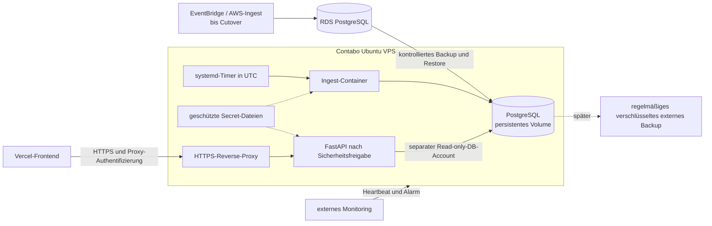

# Gesamtplan: Migration von AWS auf einen Contabo-VPS

Stand: 2026-11-07. Status: Planung; keine Umsetzung oder Freigabe.

## Grundlagen und Einzelpläne

Dieser Gesamtplan fasst die unabhängig erstellten Fachpläne zusammen und legt
bei unterschiedlichen Empfehlungen den Ablauf und die Freigabegrenzen fest:

- [AWS Cloud Expert](01-aws-cloud-expert.md)
- [AWS Principal Architect](02-aws-principal-architect.md)
- [Project Architecture Planner](03-project-architecture-planner.md)
- [Principal Software Engineer](04-principal-software-engineer.md)
- [Software Engineer](05-software-engineer.md)
- [Security](06-security.md)

Insbesondere beschreiben einzelne Fachpläne auch eine unmittelbare
API-Aktivierung oder PostgreSQL 16 als Ziel. Verbindlich für die weitere
Planung ist dagegen: API nur nach separater Freigabe aktivieren und die
Ziel-PostgreSQL-Version erst nach Prüfung der tatsächlichen RDS-Version und
Kompatibilität festlegen. Die Annahme der deaktivierten API ist durch den
read-only AWS-Abgleich vom 07.11.2026 widerlegt: Die API ist aktiv. Der
Betreiber hat entschieden, sie ebenfalls sicher auf den VPS zu migrieren.
Auf Wunsch des Betreibers wird außerdem die
Einrichtung regelmäßiger Backups auf später verschoben; die einmalige
Migrationssicherung und Restore-Probe bleiben Pflicht. Die Einzelpläne
geben die ursprünglichen, unabhängig erstellten Empfehlungen wieder.

## 1. Ziel und Geltungsbereich

Der tägliche Comunio-Ingest und PostgreSQL sollen von AWS auf einen Ubuntu-VPS
umziehen. Das Next.js-Frontend bleibt zunächst auf Vercel. Die aktive FastAPI
wird ebenfalls auf den VPS migriert, jedoch erst nach einem eigenen Sicherheits-
und Funktionstest freigegeben. Das Repository beschreibt eine AWS-Konfiguration, nicht
zwingend den aktuellen Live-Zustand: Vor dem Cutover müssen Ressourcen und
Schalter anhand des tatsächlichen AWS- und Vercel-Deployments geprüft werden.

Keine AWS-Ressourcen löschen und keine Produktionskonfiguration verändern, bevor
der Betreiber die jeweiligen Schritte ausdrücklich freigegeben hat.

## 2. Ausgangslage und geprüfter Server

- Read-only AWS-Inventur vom 07.11.2026: EventBridge ist aktiv und startet
  den Ingest um 06:00 UTC. Der API-ECS-Service ist aktiv (1 gewünschter und
  laufender Task); CloudFront ist aktiviert. Dies widerspricht dem älteren
  [AWS-Runbook](../../infra/aws/README.md). Vor dem Cutover erneut prüfen.
- Die nicht öffentliche, verschlüsselte RDS-Datenbank meldet PostgreSQL 16.14.
  Ihre tatsächliche Datenmenge und ein getesteter logischer Restore sind noch
  nicht nachgewiesen.
- Dockerfiles für [Ingest](../../backend/Dockerfile) und
  [API](../../backend/Dockerfile.api) sind vorhanden. AWS Secrets Manager ist
  jedoch noch direkt in Anwendung und Betrieb integriert.
- Read-only-SSH-Prüfung am 2026-11-07: Ubuntu 24.04.5 LTS, x86-64, 6 vCPU,
  rund 11 GiB RAM, 193 GiB Root-Dateisystem mit rund 189 GiB frei; Docker und
  Compose sind installiert. Die Server-Zeitzone ist Europe/Berlin. Dies sind
  Momentaufnahmen, keine Last-, Backup- oder Sicherheitsprüfung.
- Das vorhandene [Exportskript](../../scripts/aws/export-db.ps1) gibt
  Tabellendaten über CloudWatch-Logs aus. Es ist kein vollständiges
  PostgreSQL-Backup und soll nicht als Standard-Migrationsweg genutzt werden.

## 3. Zielbild

PostgreSQL erhält keinen öffentlich erreichbaren Port. Ein dediziertes
Docker-Netzwerk begrenzt die Kommunikation; für die Datenbankverbindung bleibt
TLS erforderlich, da [connection.py](../../backend/src/database/connection.py)
`sslmode=require` oder stärker erzwingt. Ziel ist `sslmode=verify-full` mit
passender CA und passendem Datenbank-Hostname; `require` allein prüft die
Serveridentität nicht. Zertifikats- und Schlüsselverwaltung sind zu testen. Das einzelne
System ist ein Single Point of Failure und erfüllt eine Verfügbarkeitszusage
nicht automatisch.

## 4. Entscheidungen vor Implementierung

| Entscheidung | Vorschlag / offener Punkt |
|---|---|
| Umfang | Ingest, PostgreSQL und die aktive API umziehen; VPS-API vor Cutover separat sicherheitstechnisch und funktional abnehmen. Vercel bleibt zunächst erhalten. |
| Scheduler | systemd-Timer mit expliziter UTC-Zeit und Schutz vor parallelen Läufen. Verpassten Lauf nach Neustart einmal nachholen; Sommer-/Winterzeit testen. Ein systemd-Benutzerdienst wird geprüft, sofern dauerhafter Betrieb nach Abmeldung/Neustart gewährleistet ist. |
| Datenbank | PostgreSQL-Hauptversion und Erweiterungen der RDS-Quelle vorab ermitteln; kompatible Zielversion und Dump-/Restore-Tools festlegen. |
| Secrets | Geschützte Host-Dateien, gezielt und nur lesbar in benötigte Container eingebunden; Zugriff mit tatsächlichen Container-UIDs prüfen. Kein Secret in Git, Image, Logs, Prozessargumenten oder Beispielwerten. |
| Backup | Einmalige Migrationssicherung und Restore-Probe vor Cutover sind Pflicht. Regelmäßige externe Backups und deren Automatisierung folgen später; Aufbewahrung, Speicherort, Schlüssel und Kosten sind offen. |
| RPO / RTO | Maximal tolerierbaren Datenverlust und Wiederanlaufzeit mit Betreiber festlegen; aus Tagesrhythmus keine Zusage ableiten. |
| API / Domain | Bei späterer Aktivierung erreichbare Domain, DNS, Zertifikate, Vercel-Konfiguration und vertrauenswürdige Proxy-Kette entscheiden. |
| Betrieb | Verantwortliche für Updates, Monitoring, Alarme, Migrationssicherung und Bereitschaft festlegen; Verantwortung für den späteren Backupbetrieb zuweisen. |
| Monitoring | Externer Monitoring-Dienst wird später ausgewählt und eingerichtet (offenes TODO). Bis zum nachgewiesenen Fehler- und Missing-Heartbeat-Alarm bleibt der produktive Cutover entsprechend den bestehenden Gates gesperrt. |
| AWS als Deployment-Option | AWS-Konfiguration und -Betriebsdokumentation im Repository behalten und zunächst weiterhin testen. Nach der Migration entscheiden, ob AWS dauerhaft als unterstütztes Ziel gepflegt wird. Vorhandener Code allein garantiert keinen funktionsfähigen Rückfall. |

### Repository- und Deployment-Schnitt

Die Anwendung bleibt unter `backend/` und `frontend/` gemeinsam; unter
`infra/aws/` bleibt die bestehende AWS-Konfiguration erhalten. Für das neue
Ziel wird eine getrennte Konfiguration unter `infra/vps/` vorgesehen. AWS-
und VPS-spezifische Deployment-Anleitungen und Einstellungen bleiben
getrennt; Secrets und Terraform-State gehören nicht ins Repository.

Die Secret-Anbindung wird so erweitert, dass AWS Secrets Manager auf AWS und
geschützte Dateien auf dem VPS nutzbar bleiben. Die vorhandenen
AWS-Produktionsprüfungen dürfen dabei nicht abgeschwächt werden. CI soll
weiterhin die bestehenden AWS-bezogenen Tests und Terraform-Prüfungen
ausführen; neue Tests müssen beide Secret-Provider und deren Fehlerfälle
abdecken. Vor einem erneuten AWS-Deployment müssen aktuelle Infrastruktur,
Abhängigkeiten, Secrets und Datenbestand gesondert geprüft werden.

## 5. Umsetzungsphasen und Abnahme

### Phase 0 – Inventur und Freigabe

1. Tatsächlich aktive AWS-Ressourcen, Region, Terraform-State und laufende
   Tasks inventarisieren; RDS-Version, Datenmenge, Rollen, Erweiterungen,
   Tabellen und Backup-Status feststellen. Keine Secret-Werte dokumentieren.
   Dokumentation und Terraform-Defaults sind keine verlässliche Aussage über
   den aktuellen Scheduler- oder API-Status.
2. Netzwerkpfad für das Backup aus der privaten RDS-Instanz festlegen: ein
   zeitlich begrenzter, autorisierter Zugriff aus dem AWS-Netz, ohne RDS
   öffentlich freizugeben. Übertragung und Zwischenablage verschlüsseln.
3. VPS-Nutzer, SSH-Schlüssel, Firewall, vorhandene Dienste, Speicher- und
   Backupziel prüfen; notwendige Eingriffe vorab genehmigen.
4. Wartungsfenster, RPO/RTO, Prüfer, Abbruchkriterien und Zeitraum für den
   Parallelbetrieb vereinbaren.

**Gate:** Inventur und Migrationsweg dokumentiert; Restore-Probe und Rollback
ohne Zugriff auf ungeschützte Daten möglich; Betreiberfreigabe liegt vor.

### Phase 1 – VPS und Anwendung vorbereiten

1. Ubuntu aktualisieren, administrativen Zugang absichern und getesteten
   Notfallzugang behalten. SSH-Schlüssel, Least Privilege und Firewall
   konfigurieren; nur nötige Ports freigeben. Zeitabgleich und UTC-Timer
   prüfen. Docker-Portfreigaben gesondert überprüfen, da sie nicht allein
   durch eine Host-Firewall abgesichert sind.
2. Getrennte Container für PostgreSQL, Ingest und API, persistentes DB-Volume,
   feste Images und reproduzierbares Compose-Deployment vorbereiten. VPS-API
   und Reverse-Proxy erst nach ihrem Sicherheits-Gate aktivieren; die laufende
   AWS-API bleibt bis zur freigegebenen Umschaltung bestehen.
3. AWS-unabhängige Secret-Datei-Unterstützung ergänzen und testen, ohne
   Produktionsschutz zu umgehen: Der bestehende Produktionsmodus verlangt
   Secret-Mode; Auth und Proxy-Secret haben eigene Startbedingungen. Secrets
   je Dienst trennen, fehlende oder ungültige Werte fail-closed behandeln,
   Rotation und Neustartverhalten dokumentieren. Berechtigungen müssen sowohl
   den Hostzugriff beschränken als auch zum nicht privilegierten
   Container-Benutzer passen; root-only ist nicht ohne weiteres ausreichend.
   Die bestehende AWS-Secret-Integration erhalten und beide Provider testen.
4. PostgreSQL-TLS, separate Schreib- und API-Leserollen sowie Dateizugriff
   durch den nicht privilegierten Container-Benutzer einrichten und testen.
5. Timer mit 06:00 **UTC**, Überlappungsschutz, Fehler- und
   Missing-Heartbeat-Alarm aufsetzen. Login-Retry und Wiederanlaufverhalten
   gegenüber dem AWS-Vertrag prüfen.
6. Log-Retention und Benachrichtigung aufbauen. Die einmalige
   Migrationssicherung geschützt und verschlüsselt außerhalb des VPS
   aufbewahren und ihre Restore-Prozedur dokumentieren. Regelmäßige
   Backups und Backup-Überwachung werden nicht in dieser Phase eingerichtet.

**Gate:** Tests auf isolierter Umgebung, negativer Secret-/Rechtetest,
Restore-Probe der Migrationssicherung und Alarmtest erfolgreich; kein
produktiver Ingest aktiviert.

### Phase 2 – Generalprobe der Datenmigration

1. Konsistenten PostgreSQL-Dump mit passender `pg_dump`-Version erstellen und
   sicher übertragen; Wiederherstellung auf einem isolierten Ziel testen.
   Rollen, Rechte und RDS-spezifische Eigenschaften getrennt betrachten;
   keine Übernahme von RDS-Administratorrollen voraussetzen.
2. `schema_migrations`, Tabellen, Constraints, Indizes, Sequenzen und
   aussagekräftige Tabellenzählungen sowie fachliche Zeiträume zwischen
   Quelle und Ziel prüfen. Kollation, Zeitzone, Erweiterungen und
   Sequenzwerte durch kontrollierte Tests auf einer Kopie verifizieren.
3. Anwendungsmigrationen und einen reproduzierbaren Fixture-Ingest auf einer
   **isolierten Kopie** testen; Live-Snapshot nicht parallel gegen produktive
   Quelle und Ziel ausführen.
4. Wiederherstellung aus der einmaligen Migrationssicherung separat üben. Laufzeiten,
   Speicherbedarf und Abweichungen für das Cutover-Fenster dokumentieren.

**Gate:** Prüfergebnisse nachvollziehbar, Datenstand vollständig und Restore
nachweislich erfolgreich; Cutover-Zeitfenster und Rückfall getestet.

### Phase 3 – Cutover mit genau einem aktiven Writer

1. AWS-Schedule deaktivieren und bestätigen; bereits gestartete ECS-Tasks
   vollständig beenden lassen. Weitere manuelle oder automatisierte Writer
   sperren und den Stillstand prüfen.
2. Nach dem Schreibstopp finalen konsistenten Dump erstellen, sicher
   übertragen und auf dem vorbereiteten Ziel wiederherstellen. Mit einem
   unabhängig gesicherten Backup und einem klaren Quell-Zeitpunkt arbeiten;
   vorhandene Probedaten dürfen den finalen Restore nicht verfälschen.
3. Daten und `schema_migrations` erneut vergleichen, Rechte, TLS,
   Migrationssicherung und Monitoring prüfen. Quelle weiterhin unverändert
   behalten.
4. Nach ausdrücklichem Go den VPS-Writer aktivieren und genau einen
   kontrollierten Live-Lauf durchführen; Zeitfenster und Ergebnis im
   Betriebsprotokoll festhalten. Timer erst danach aktivieren.
5. Nächsten geplanten 06:00-UTC-Lauf, Heartbeat und Log-Ereignisse prüfen;
   der AWS-Schedule bleibt währenddessen deaktiviert.
6. Die auf dem VPS abgenommene API über HTTPS und den Vercel-Proxy
   umschalten; bis dahin zeigt die AWS-API weiterhin auf den alten Datenstand.
   Dieses Wartungsfenster vorab ankündigen und nur mit Freigabe durchführen.

**Gate:** Datenabgleich und kontrollierter Lauf erfolgreich, genau ein
Scheduler aktiv, keine Duplikate, Fehler- und Ausfallalarm funktionieren.

### Phase 4 – Stabilisierung und AWS-Abbau

1. Mehrere Tagesläufe beobachten; als Vorschlag mindestens drei
   aufeinanderfolgende erfolgreiche geplante Fenster wie im bisherigen
   [Scheduler-Vertrag](../../architecture.md), zusätzlich den Nachweis der
   Restore-Probe für die Migrationssicherung.
2. Restabhängigkeiten von AWS prüfen, insbesondere Secret-Zugriff, Images,
   Aufgaben, Alarmierung und Terraform-State. Kosten- und
   Ressourceninventar mit tatsächlichem Account abgleichen. AWS-Code und
   Dokumentation im Repository erhalten; separat entscheiden, wie lange
   AWS als unterstütztes Deployment-Ziel gepflegt wird.
3. Erst nach gesonderter Freigabe und Ablauf des vereinbarten
   Rückfallzeitraums Ressourcen kontrolliert abbauen; finalen Snapshot,
   Aufbewahrung, Zugriff auf State und Wiederherstellung berücksichtigen.
   Kein pauschales `terraform destroy`.

### Nachgelagert – regelmäßige Backups

Nach dem Umzug externe, verschlüsselte und regelmäßig ausgeführte
Datenbanksicherungen samt Aufbewahrungsregeln, Alarmierung und wiederkehrenden
Restore-Tests einrichten. Termin und verantwortliche Person sind noch
festzulegen. Bis dahin schützt die einmalige Migrationssicherung nur den
gesicherten Stand; spätere VPS-Daten können bei einem Ausfall verloren gehen.
Ein definiertes RPO/RTO ist ohne passenden Sicherungs- und Wiederanlaufprozess
nicht nachgewiesen. Vor dem AWS-Abbau dieses Restrisiko ausdrücklich bewerten
und freigeben; die einmalige Sicherung und ihren Schlüssel sicher aufbewahren.

## 6. Rückfall und Datenkonsistenz

Vor dem ersten VPS-Schreibvorgang kann nach Fehlerbehebung der
AWS-Scheduler wieder aktiviert werden, nachdem sichergestellt ist, dass der
VPS-Writer und Timer inaktiv sind. Nach einem erfolgreichen VPS-Schreibvorgang
ist RDS dagegen veraltet: Nicht einfach zurückschalten. Zunächst VPS-Writer
anhalten, Änderungen nach dokumentierter Strategie sichern und nach RDS
zurückführen oder einen explizit akzeptierten Datenverlust festlegen.
Erst nach Datenabgleich AWS wieder als alleinigen Writer aktivieren. Wenn
Reconciliation nicht möglich ist, ist der Rückfall blockiert und erfordert
Betreiberentscheidung.

## 7. API-Migration und Sicherheits-Gate

Die VPS-API nicht während des Daten-Cutovers ungeprüft öffentlich schalten.
Voraussetzungen sind HTTPS, DNS, ein eigener Read-only-DB-Nutzer, getrennte
Secrets und Vercel-seitige Proxy-Konfiguration. Der bestehende Login nutzt
CloudFront-spezifische Client-IP-Auswertung; beim Wechsel müssen
vertrauenswürdige Proxy-Header und das Rate-Limiting Ende-zu-Ende neu
entworfen und gegen gefälschte Header getestet werden. Der neue Proxy muss
clientseitig gelieferte Vertrauens-Header entfernen oder überschreiben;
das pro Prozess gehaltene Login-Limit braucht eine zusätzliche geeignete
Schutzschicht. Die bestehenden Vercel-Routen reichen keine Client-IP weiter;
die Herkunft der tatsächlichen Client-IP ist daher am VPS bislang nicht
nachgewiesen. Vor Freigabe müssen Vercel-seitige IP-Authentizität, ein
geeigneter gemeinsamer Login-Limiter und das Verhalten bei gefälschten Headern
geprüft werden; der laufende AWS-CloudFront-Pfad darf dabei nicht versehentlich
geändert werden. HTTPS, Login,
Sessions, Proxy-Authentifizierung, CORS, Health-Checks und
Wiederherstellung nach Neustart werden separat abgenommen.

## 8. Aufwandsrahmen und Einschränkungen

Als grobe Planungsannahme: 3–5 Arbeitstage für Implementierung und
kontrollierte Migration bei geklärten Zugängen und Backupziel; Sicherheits-,
Infrastruktur- und Betriebsanforderungen können das deutlich erhöhen.
Beobachtungszeit über mehrere tägliche Scheduler-Fenster kommt zusätzlich
hinzu. Preise und laufende Kosten sind nicht verifiziert.
