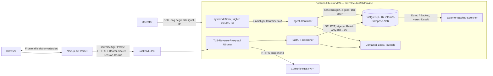

# Comunio Data Website — Architekturplan AWS → Contabo Ubuntu

> **Zweck:** Eigenständiger, repositorybezogener Ziel- und Migrationsplan. Dieses Dokument beschreibt eine Zielarchitektur und überprüfbare Arbeitsschritte; es bestätigt weder einen Contabo-Vertrag noch den Live-Zustand von AWS. Es wurden keine Server kontaktiert und keine Infrastruktur geändert.

> **Aktualisierung 2026-11-08:** Dieser Architekturplan dokumentiert den
> Vorab-Stand. Die VPS-Migration und der Frontend-Cutover wurden anschließend
> umgesetzt; aktueller Betriebsstand und offene Arbeiten stehen in der
> [Projektübersicht](../../README.md) und im
> [VPS-Runbook](../../infra/vps/README.md). Die damaligen Aussagen zu
> deaktivierter API und offenen Portabilitätsblockern sind keine aktuelle
> Betriebsanzeige.

## Kurzempfehlung

Für den aktuellen Umfang ist ein einzelner Ubuntu-VPS mit Docker Compose, PostgreSQL, FastAPI und einem geplanten Einmal-Ingest die praktikable Zielarchitektur. Das Next.js-Frontend bleibt zunächst auf Vercel. Ein TLS-Reverse-Proxy bildet den einzigen öffentlichen Backend-Einstieg. PostgreSQL wird nur intern erreichbar gemacht und durch verschlüsselte, externe Backups abgesichert.

Vor einem produktiven Umzug bestehen **zwei konkrete Portabilitätsblocker**: Der Ingest lädt Comunio-Zugangsdaten aus AWS Secrets Manager; die API lädt ihr Authentifizierungsgeheimnis ebenfalls über boto3/AWS Secrets Manager. Diese Laufzeitabhängigkeiten müssen durch einen für den VPS geeigneten Secret-Lieferweg ersetzt oder nachweislich entkoppelt werden. Keine AWS-Zugangsschlüssel als dauerhafte VPS-Lösung hinterlegen. Die API ist laut Repository-Dokumentation aktuell abgeschaltet. Der Umzug muss daher API-Aktivierung und Vercel-Anbindung als eigenen Freigabeschritt behandeln.

Die Architektur hat auf einem VPS einen gemeinsamen Ausfallpunkt. Sie ist eine kostenschonende Betriebsvereinfachung, **keine HA-Architektur** und kein belegter Nachweis für 99,9 % Verfügbarkeit.

## Repository-Befund und Planungsannahmen

**Belegte Repository-Fakten**

- Das Backend enthält einen Python-3.11-Ingest, PostgreSQL-Migrationen und FastAPI; die vorhandenen Containerdefinitionen sind [backend/Dockerfile](../../backend/Dockerfile) und [backend/Dockerfile.api](../../backend/Dockerfile.api).
- Die Datenbank ist PostgreSQL; die AWS-Konfiguration setzt PostgreSQL 16 ein. Das Schema und die Historisierung sind in [data_model.md](../../data_model.md) beschrieben.
- Der Ingest läuft derzeit täglich um 06:00 UTC über EventBridge/ECS; Login-Wiederholungen, Idempotenz und Betriebsprüfungen sind im [AP-9-Runbook](../../backend/OPERABILITY-AP9.md) beschrieben.
- Die API ist read-only gegenüber der Datenbank, bietet `/health/live` und `/health/ready` und ist in der aktuellen Dokumentation deaktiviert. Der API-Status, der alte HTTP-ALB und die noch nicht angewendete neuere CloudFront-Konfiguration sind in [infra/aws/README.md](../../infra/aws/README.md) ausdrücklich abgegrenzt.
- Das Frontend ist Next.js auf Vercel; sein serverseitiger Proxy erwartet `NEXT_PUBLIC_API_BASE_URL` und `API_PROXY_SECRET` (siehe [frontend/package.json](../../frontend/package.json) und [Proxy-Route](../../frontend/app/api/proxy/%5B...path%5D/route.ts)).
- Die API-Authentifizierung und der Ingest verwenden derzeit AWS-spezifische Secret-Zugriffe; siehe [API-Auth](../../backend/src/api/auth.py), [API-Konfiguration](../../backend/src/api/app.py) und [Ingest-Client](../../backend/src/ingest/comuniopy_client.py).

**Annahmen, vor Umsetzung zu bestätigen**

- Ein einzelner VPS genügt für das aktuelle Produktvolumen; gleichzeitige Nutzer-, Last-, Datenbankgrößen- und Verfügbarkeitsmessungen liegen in den gelesenen Unterlagen nicht vor.
- Vercel bleibt bestehen, die Domain kann auf einen HTTPS-Backend-Host zeigen und ein externer Backup-Speicher ist verfügbar.
- Als Start-Hypothese werden **4 vCPU, 8 GB RAM und 100 GB SSD/NVMe** eingeplant. Das ist keine Contabo-Produktempfehlung oder Preisangabe: vor Bestellung gegen tatsächliche DB-Größe, verfügbaren Speicher, Laufzeitmessungen und den konkreten Tarif prüfen. Betriebssystem und Docker-Images müssen für die gewählte CPU-Architektur kompatibel sein.

## Zielarchitektur

### Entscheidungen und Abgrenzung

| Bereich | Ziel / Abwägung |
|---|---|
| Architekturstil | **Modularer Single-Host-Deployment-Schnitt** mit getrennten API- und Ingest-Prozessen. Vorhandene fachliche Grenzen bleiben erhalten, aber ein VPS ersetzt ECS, EventBridge und RDS. Für den jetzigen Umfang weniger Betriebsaufwand als Microservices/Kubernetes; dafür gemeinsame Ausfalldomäne und keine unabhängige Skalierung. |
| Ingress | Reverse-Proxy (z. B. Caddy oder Nginx) auf dem Host mit automatisiertem TLS. Nur TCP 80/443 öffentlich. API-Port und PostgreSQL-Port nicht öffentlich veröffentlichen. |
| Laufzeit | Docker Engine + Compose für API und PostgreSQL; Ingest als kurzlebiger Container, gestartet durch systemd-Timer. Kein dauerhaft laufender Scheduler-Container. Images über unveränderliche Tags/Commit-SHAs deployen, nicht `latest`. |
| Datenbank | PostgreSQL 16 zunächst auf demselben VPS. API erhält nur einen Read-only-DB-Zugang, Ingest einen separaten Schreibzugang. Datenbank nur im privaten Container-Netz bzw. Loopback. Nachteil: Host-Ausfall betrifft API, Ingest und DB zugleich. |
| DB-Verbindung | Das Backend erzwingt derzeit `sslmode=require` oder stärker. Ziel-URL und PostgreSQL-TLS-Konfiguration müssen diese Prüfung erfüllen; `sslmode=disable` nicht ungeprüft als Abkürzung verwenden. |
| Secrets | Für den VPS vorgesehener Secret-Mechanismus mit eingeschränkten Dateirechten und kontrollierter Rotation, z. B. root-geschützte Runtime-Dateien außerhalb des Repositorys; nicht in Images, Git, Compose-Dateien oder Logs. Die Anwendung benötigt dafür aktuell noch AWS-Secret-Provider-Änderungen bzw. eine kompatible Secret-Übergabe. |
| Beobachtbarkeit | Strukturierte Anwendungsereignisse weiterverwenden; Docker/journald-Rotation, externe Erreichbarkeitsprüfung für HTTPS und Alarmierung für fehlgeschlagene Läufe/Backups. CloudWatch-Alarme und EventBridge-DLQ werden nicht automatisch durch den VPS ersetzt. |
| Frontend | Zunächst Vercel beibehalten, nur den API-Base-URL-Wert auf die HTTPS-Domain umstellen. Server-seitiges Proxy-Secret bleibt server-only. Browser sollen nicht direkt mit einem ungeschützten API-Origin sprechen. |

Ein Container-Volume ist kein Backup. Ein Host-Snapshot allein ersetzt weder ein unabhängiges Backup noch einen Wiederherstellungstest.

## Abhängigkeiten und Umzugsschnitt

| Abhängigkeit heute | Zielbehandlung / Freigabebedingung |
|---|---|
| AWS Secrets Manager: Comunio-Zugangsdaten | Secret sicher zum Zielbetrieb überführen und die Ingest-Konfiguration von `COMUNIO_SECRET_NAME`/AWS-Client auf den genehmigten VPS-Secret-Lieferweg umstellen. Keine AWS-Schlüssel als Ersatz einbetten. |
| AWS Secrets Manager: `AUTH_SECRET_ARN` | Auth-Konfiguration der API muss VPS-kompatibel sein. Bestehende Benutzername-/bcrypt-Hash-/JWT-Secret-Struktur bei der Übergabe schützen; niemals Werte protokollieren. Session- und Rotationseffekt vor dem Wechsel testen. |
| AWS `DATABASE_URL` und AWS-Region | Ziel-Datenbank-URL für PostgreSQL erzeugen, TLS-Verhalten der bestehenden Backend-Validierung berücksichtigen und getrennte Rollen/Passwörter konfigurieren. Die AWS-Region wird für den VPS-Betrieb nicht als AWS-Zugriffsvoraussetzung benötigt. |
| ECR / ECS / EventBridge | Container-Image lokal oder in einer neutral erreichbaren Registry bauen und per immutablem Tag ausrollen. systemd-Timer übernimmt den UTC-Trigger; er übernimmt nicht automatisch CloudWatch-Retry/DLQ-Verhalten. |
| RDS PostgreSQL | Dump/Restore-Migration. Zielversion, Erweiterungen, Rollen, Schema-Migrationsstand, Kollation/Zeitzone und Datenintegrität vor Umschaltung prüfen. Private Netzwerkverbindung und Backup-/Restore-Verfahren festlegen. |
| CloudFront / ALB / TLS | VPS-DNS und HTTPS-Reverse-Proxy bilden den neuen API-Origin. Das alte HTTP-ALB nicht mit Authentifizierungsdaten weiterverwenden. Vor DNS-/Vercel-Wechsel den neuen HTTPS-Endpunkt getrennt testen. |
| Vercel Proxy / CORS | `NEXT_PUBLIC_API_BASE_URL` und serverseitiges `API_PROXY_SECRET` über Vercel konfigurieren; API-Origin/CORS exakt auf benötigte Origins begrenzen. API-Proxy-Secret serverseitig halten. |
| CloudWatch / SNS / DLQ | Externe HTTPS- und Prozess-/Backup-Alarme neu einrichten. Für den ersten Betrieb mindestens Ingest-Erfolg, DB-Readiness, Speicherplatz, Backup-Alter und TLS-Ablauf überwachen. |

### Praktikabler Deployment-Schnitt

1. **Portabilität vor Infrastruktur:** AWS-Secret-Zugriffe in API und Ingest als explizite Umzugsblocker bearbeiten. Bestehende Unit-/Integrationstests, Produktionsmodus und Secret-Rotation gegen den Ziel-Lieferweg testen. Keine Anwendungsänderung ist Bestandteil dieser Dokumentdatei.
2. **Zielhost ohne produktive Umschaltung vorbereiten:** Ubuntu aktualisieren, administrativen Zugang absichern, Firewall-Regeln und eingeschränkten SSH-Zugang setzen, Docker installieren, DNS/TLS vorbereiten. Compose-Netze und persistentes Datenbank-Volume festlegen; nur Reverse-Proxy-Ports öffentlich.
3. **Datenbank-Probe:** Datenbankgröße und Version erfassen, konsistenten Dump aus RDS erzeugen, nach Möglichkeit verschlüsselt übertragen und in eine isolierte Zielinstanz einspielen. Prüfen, ob Schema-Migrationen bereits angewendet sind; nicht blind nochmals destruktiv ausführen. Tabellenzahlen, jüngste Snapshot-Tage, Schlüssel/Constraints und repräsentative Abfragen vergleichen.
4. **Anwendungs-Probe:** API und Ingest mit getrennten Datenbankrollen starten. `/health/live`, `/health/ready`, API-Contract/Read-only-Verhalten sowie einen kontrollierten Ingest-Lauf gegen die Ziel-DB prüfen. Während der Probe keine parallelen produktiven Scheduler aktivieren.
5. **Cutover:** Wartungs-/Schreibfenster festlegen; AWS EventBridge-Schedule deaktivieren und verifizieren, dass kein Ingest-Task mehr läuft. Letzten konsistenten RDS-Dump übertragen/einspielen, API und Ingest auf Ziel aktivieren, danach Vercel-API-URL umstellen. DNS-TTL, Session-Verhalten und Rückfallzeitfenster vorab festlegen.
6. **Stabilisierung und Rückbau:** Mindestens drei aufeinanderfolgende tägliche Ziel-Läufe prüfen. AWS-Ressourcen, RDS und nötige Secrets erst nach dokumentierter Abnahme, Backup-Prüfung und festgelegtem Rückfallzeitraum abbauen. Terraform-State und produktive AWS-Ressourcen nicht allein aufgrund dieses Plans ändern.

## Ressourcen, Betrieb und Kostenannahmen

### Host- und Betriebsressourcen

- **Startgröße als zu validierende Hypothese:** 4 vCPU, 8 GB RAM, 100 GB SSD/NVMe. Mindestens 2 GB RAM als System-/Containerreserve einplanen; echte Reserven durch Lastmessung bestätigen. Datenbankgröße, Backup-Kopien und Logs müssen in die Speicherkapazität einfließen.
- **Disk:** PostgreSQL-Daten, WAL, Containerdaten und Logs getrennt überwachen. Warnschwelle für belegten Speicher und Inode-Auslastung setzen; genügend freier Platz für Dump/Restore bzw. temporäre Backup-Dateien vorhalten.
- **Backup:** Tägliche konsistente PostgreSQL-Sicherung, verschlüsselt und außerhalb des VPS gespeichert; Aufbewahrungsdauer nach fachlicher Wiederherstellungsanforderung festlegen. Regelmäßiger Restore-Test auf separater Instanz. Synchronisierte Kopie auf derselben VM ist kein Offsite-Backup.
- **Sicherheit:** SSH-Schlüssel, nicht-root-Administrationskonto, eng begrenzte SSH-Quell-IP, Host-Firewall, zeitnahe Sicherheitsupdates und minimal exponierte Container. Secrets mit restriktiven Dateirechten, Rotations-/Notfallverfahren und Zugriffskontrolle.
- **Betriebsaufwand:** Updates, Host-Härtung, TLS, Backups, Restore-Tests, Monitoring und Incident-Reaktion liegen beim Betreiber. Der VPS-Anbieter übernimmt damit nicht automatisch die Aufgaben, die zuvor auf AWS Managed Services verteilt waren.
- **Verfügbarkeit:** Single Host, Single DB und einzelnes lokales Volume sind Single Points of Failure. Backup reduziert Datenverlust-Risiko, aber keine Ausfallzeit. Für verbindliche hohe Verfügbarkeit wäre mindestens eine getrennte Datenbank-/Compute-Ausfalldomäne samt getesteter Failover-Prozedur erforderlich.

### Kostenmodell ohne unbelegte Preisangaben

Es liegen keine verifizierten Contabo-Angebotsdaten, Tarifbedingungen, Snapshot-/Backuppreise oder aktuellen AWS-Rechnungsdaten vor. Daher werden hier **keine Monatsbeträge behauptet**.

| Kostenblock | Zielbetrieb / Annahme | Was für einen belastbaren Betrag fehlt |
|---|---|---|
| Contabo Compute | Ein VPS passend zur validierten Ressourcen-Hypothese | konkreter Tarif, Laufzeit, enthaltene CPU/RAM/Disk und Abrechnungsbedingungen |
| Speicher/Backups | Externer Speicher für verschlüsselte Dumps; ggf. zusätzliche VPS-Snapshots | Datenvolumen, Änderungsrate, Aufbewahrung, Transfer-/Snapshotpreise |
| Netzwerk/DNS/TLS | Domain/DNS und ausgehender/öffentlicher Traffic; TLS per Reverse-Proxy | Domainstatus, Trafficvolumen und Tarifgrenzen |
| Vercel | Frontend bleibt zunächst bestehen | bestehender Plan und Nutzung |
| Betrieb | Adminzeit für Updates, Monitoring und Restore-Tests | interne Stundensätze und gewünschte Betriebszeiten |
| AWS-Übergang | temporär parallel betriebene RDS-/ECS-/Netzwerkressourcen bis Abnahme | tatsächliche AWS-Ressourcen und Rechnung; Parallellaufdauer |

**Vergleichsformel:** Ziel-Monatskosten = VPS-Tarif + externe Backup-/Speicherkosten + Domain/DNS + Vercel-Anteil + bezifferter Betriebsaufwand. Übergangskosten zusätzlich mit verbleibenden AWS-Kosten für die Parallelphase ansetzen. Belege: konkrete Anbieterangebote, eigene AWS-Abrechnung und gemessene Nutzung; vor Freigabe mit Datum dokumentieren. Einsparungen gegenüber AWS nicht allein aus Listenpreisen ableiten, sondern Managed-Services, Backup, Personalaufwand, Verfügbarkeit und Risiko mitrechnen.

## Validierbare Zielkriterien (Abnahme)

Alle Kriterien sind vor Produktivfreigabe nachzuweisen; dieser Plan behauptet nicht, dass sie bereits erfüllt sind.

1. **Portabilität:** API und Ingest starten im Produktionsmodus ohne Zugriff auf AWS Secrets Manager oder AWS-Identitäten; Secrets werden weder in Git/Image/Logs noch in Kommandozeilenargumenten offengelegt.
2. **Netzwerk/Security:** Von extern sind nur die freigegebenen HTTPS- und ggf. HTTP-Redirect-Ports erreichbar. PostgreSQL und API-Container-Port sind nicht öffentlich erreichbar; Adminzugriff ist eingeschränkt. TLS-Zertifikat ist gültig.
3. **API:** `/health/live` liefert erfolgreich; `/health/ready` liefert nur bei erreichbarer Ziel-Datenbank „ready“. Nicht autorisierte Requests erhalten die erwarteten Fehler; Vercel-Proxy kann mit Server-Secret und gültiger Session die vorhandenen API-Verträge abrufen. API-DB-Rolle kann keine Schreiboperationen durchführen.
4. **Daten:** Wiederhergestellte Datenbank hat erwarteten Schema-Migrationsstand, gültige Constraints und übereinstimmende Tabellen-/Snapshot-Prüfwerte. API liefert für repräsentative Spieler-, Team-, Transfermarkt- und Historienabfragen dieselben fachlichen Ergebnisse wie die Vergleichsbasis.
5. **Ingest:** Ein kontrollierter Lauf erzeugt erwartete Datensätze; ein wiederholter Lauf dupliziert keine Marktwertzeilen. Scheduler läuft genau einmal täglich um 06:00 UTC; ein fehlgeschlagener Lauf ist erkennbar und manuell wiederholbar.
6. **Backup/Wiederherstellung:** Ein Offsite-Backup ist verschlüsselt vorhanden; Restore auf eine leere Testdatenbank ist erfolgreich, Dauer und wiederhergestellte Daten werden protokolliert.
7. **Stabilität/Leistung:** Drei aufeinanderfolgende tägliche Ingest-Fenster sind erfolgreich, ohne Datenbank- oder Duplikatfehler. Erreichbarkeit, Fehlerquote, Antwortzeit und RAM-/Disk-Spitzen werden über diesen Zeitraum gemessen. Die bestehende Architektur nennt <2 Sekunden Ladezeit und 99,9 % Verfügbarkeit als nicht-funktionale Ziele; Messdefinition und Erfüllung sind vor Freigabe nachzuweisen. Eine einzelne VPS-Ausfalldomäne garantiert 99,9 % nicht.
8. **Rückfall:** Vor dem Cutover getesteter Rückfallweg zu AWS ist dokumentiert; AWS Scheduler bleibt während VPS-Validierung ausgeschaltet, damit keine konkurrierenden Schreibläufe entstehen.

## Risiken und Maßnahmen

| Risiko | Maßnahme / Verantwortlichkeit |
|---|---|
| AWS-Secret-Code blockiert VPS-Start | Backend-Verantwortliche implementieren und testen Secret-Portabilität vor Host-Cutover. |
| Fehlerhafte oder unvollständige DB-Übernahme | DB-Verantwortliche führen konsistenten Dump, Prüfsummen/Counts und Restore-Probe durch; AWS-Quelle bis Abnahme erhalten. |
| Doppelter Tages-Ingest beim Wechsel | Betrieb deaktiviert und verifiziert EventBridge vor Aktivierung des systemd-Timers. |
| VPS-Ausfall oder Volume-Verlust | Betreiber akzeptiert dokumentierte Single-Host-SLO-Grenze oder finanziert getrennte Redundanz; Offsite-Restore regelmäßig nachweisen. |
| Hinter Reverse-Proxy falsche Client-IP/Rate-Limit | API-/Betriebsverantwortliche konfigurieren vertrauenswürdige Proxy-Header ausschließlich für den lokalen Proxy. `CloudFront-Viewer-Address` darf nicht als ungeprüfter öffentlicher Header vertraut werden. Login-Rate-Limit testen. |
| Kosten-/Tarifannahmen unzutreffend | Budgetverantwortliche bestätigen konkretes Anbieterangebot plus Backup und Betrieb; keine Preisentscheidung aus diesem Dokument ableiten. |
| Compliance/Datenschutz unklar | Verantwortliche prüfen Speicherort, Backup-Aufbewahrung, Zugriff und etwaige Datenschutzpflichten vor Freigabe. |

## Relative Quellen

- [Projektübersicht / aktueller Status](../../README.md)
- [Zielarchitektur und API-Vertrag](../../architecture.md)
- [Datenmodell](../../data_model.md)
- [AWS-Baseline und dokumentierter API-Status](../../infra/aws/README.md)
- [AP-9 Scheduler-Runbook](../../backend/OPERABILITY-AP9.md)
- [Backend-Produktionskonfiguration](../../backend/src/config.py)
- [API-Authentifizierung](../../backend/src/api/auth.py)
- [API-Anwendung und Proxy-/Health-Verhalten](../../backend/src/api/app.py)
- [Ingest Comunio-Adapter](../../backend/src/ingest/comuniopy_client.py)
